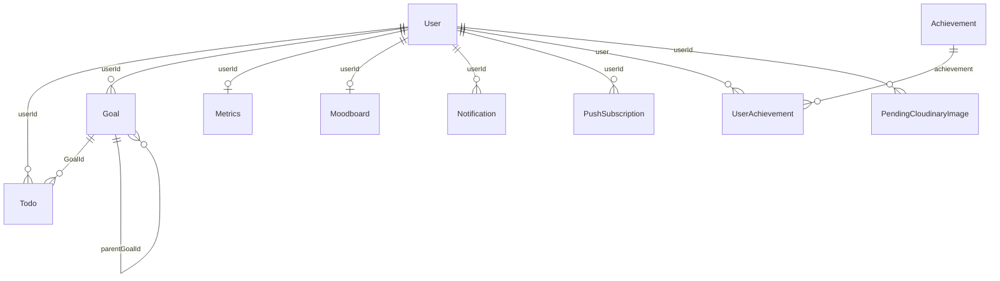

# Documentación técnica — Nuri Task API

Documento de referencia para entender el backend de punta a punta: qué resuelve, cómo está armado, por qué se tomaron ciertas decisiones y dónde buscar cada cosa. Está verificado contra el código del repositorio, no contra resúmenes desactualizados.

**Repositorio:** [github.com/leo2143/nuri-task-api](https://github.com/leo2143/nuri-task-api)  
**API en producción:** https://nuri-task-api.vercel.app  
**Swagger:** https://nuri-task-api.vercel.app/api-docs  
**Frontend que lo consume:** [nuri-task-app](https://github.com/leo2143/nuri-task-app)

---

## Índice

1. [Qué es Nuri Task y qué resuelve](#1-qué-es-nuri-task-y-qué-resuelve)
2. [Cómo levantarlo](#2-cómo-levantarlo)
3. [Arquitectura en capas](#3-arquitectura-en-capas)
4. [Modelo de datos](#4-modelo-de-datos)
5. [Catálogo de la API](#5-catálogo-de-la-api)
6. [Validación con Zod y DTOs](#6-validación-con-zod-y-dtos)
7. [Autenticación y seguridad](#7-autenticación-y-seguridad)
8. [Reglas de negocio](#8-reglas-de-negocio)
9. [Integraciones externas](#9-integraciones-externas)
10. [Despliegue y operación](#10-despliegue-y-operación)
11. [Calidad y resiliencia](#11-calidad-y-resiliencia)
12. [Deuda técnica y limitaciones](#12-deuda-técnica-y-limitaciones)
13. [Mapa de archivos](#13-mapa-de-archivos)

---

## 1. Qué es Nuri Task y qué resuelve

Nuri Task es una API REST para una app de productividad con acompañamiento emocional. No es solo un CRUD de listas: el dominio gira alrededor de **formar hábitos** (tareas diarias), **objetivos de largo plazo** (metas y submetas) y **motivación** (rachas, logros, moodboard, notificaciones).

El backend es el dueño de la verdad: valida, persiste, aplica reglas (por ejemplo, una tarea confirmada no se puede editar) y habla con servicios externos (email, MercadoPago, Cloudinary, Web Push).

### Glosario de dominio

| Concepto | Qué es |
|----------|--------|
| **Usuario** | Persona con email. Puede registrarse con contraseña o con Google. Tiene rol `isAdmin` y un objeto `subscription`. |
| **Tarea (Todo)** | Acción concreta. Prioridad `low` / `medium` / `high`, fecha opcional, comentarios. Puede vincularse a una meta. |
| **Tarea bloqueada (`isLocked`)** | Al marcarse completada, queda irreversible para el usuario. Evita “descompletar” para inflar rachas o logros. |
| **Meta (Goal)** | Objetivo de más alcance. Estados: `active`, `paused`, `completed`. Puede tener **submetas** (`parentGoalId`). |
| **Progreso de meta** | Porcentaje 0–100 calculado **solo con las tareas** de esa meta (`completedTasks / totalTasks`). Las submetas no entran en la fórmula. |
| **Racha (streak)** | Días consecutivos con al menos una tarea completada. Vive en el documento `Metrics` del usuario. |
| **Logro (Achievement)** | Plantilla global (admin). El progreso por usuario está en `UserAchievement`. Se dispara por eventos (`task:completed`, `goal:completed`, `streak:updated`). |
| **Tier de logro** | `basic` (todos) o `premium` (visible para free, pero no accesible). |
| **Moodboard** | Tablero 1:1 de imágenes inspiracionales. Requiere suscripción activa (o admin). |
| **Premium** | `subscription.isActive === true` (vía MercadoPago o seteo admin). Desbloquea moodboard, dashboard de métricas y metas ilimitadas. El plan free permite **2 metas**. |
| **Notificación in-app** | Registro en Mongo. Tipos: vencimiento, riesgo de racha, inactividad, subida de racha, logro completado. |
| **Push** | Misma información enviada al navegador vía Web Push (VAPID). |
| **Onboarding** | Flag `onboardingCompleted`. El front redirige hasta que el usuario lo marca. |
| **Email verificado** | `emailVerified`. Sin esto el front no deja entrar a la app. |

### Stack (versión del `package.json`)

| Pieza | Tecnología | Para qué |
|-------|------------|----------|
| Runtime | Node.js 20+, ESM (`"type": "module"`) | Módulos nativos, top-level await |
| HTTP | Express 5.1 | Ruteo y middleware |
| Base de datos | MongoDB + Mongoose 8.18 | Documentos, índices, query middleware |
| Validación | Zod 3.25 | Contratos de entrada (DTOs) |
| Auth | jsonwebtoken + bcrypt + cookie-parser | Sesión en cookie HttpOnly |
| Email | Nodemailer 7 | Verificación y reset |
| OAuth | google-auth-library | Login con Google |
| Imágenes | cloudinary | Perfil, moodboard, logros |
| Pagos | API REST de MercadoPago | Preapproval mensual |
| Push | web-push | Notificaciones del navegador |
| Rate limit | express-rate-limit | Frenar fuerza bruta en auth |
| Serverless | @vercel/functions (`waitUntil`) | Trabajo post-respuesta en Vercel |

---

## 2. Cómo levantarlo

### Requisitos

- Node.js 20+
- npm 10+
- MongoDB 6+ (local o [Atlas](https://www.mongodb.com/cloud/atlas))

### Pasos

```bash
git clone https://github.com/leo2143/nuri-task-api.git
cd nuri-task-api
npm install
cp .env.example .env
# Completar .env (JWT_SECRET y MONGO_URI son obligatorios)
npm start
```

El servidor local escucha en `PORT` (default `3000`). Swagger: `http://localhost:3000/api-docs`.

`npm install` corre `postinstall` → regenera `swagger_output.json`.

### Scripts

| Script | Qué hace |
|--------|----------|
| `npm start` | `node index.js` — servidor local |
| `npm run dev` / `npm run swagger` | Regenera Swagger y, si no está en Vercel, levanta la app |
| `npm run lint` | ESLint |
| `npm run format` / `format:check` | Prettier |
| `npm run docs` / `docs:serve` | JSDoc HTML |
| `npm test` | Placeholder: no hay tests automatizados |

### Variables de entorno

Solo nombres y propósito. Los valores reales van en `.env` (nunca en el repo).

| Variable | Obligatoria | Propósito |
|----------|-------------|-----------|
| `MONGO_URI` | Sí (persistencia) | Conexión MongoDB |
| `JWT_SECRET` | Sí (el boot falla si falta) | Firma y verificación del JWT |
| `PORT` | No en Vercel | Puerto local (default 3000) |
| `NODE_ENV` | No | `development` cambia cookies y expone `devToken` en reset |
| `FRONTEND_URL` | Recomendada | Origin extra de CORS + links en emails |
| `API_URL` | Recomendada | URL pública (back-url de MercadoPago) |
| `EMAIL_SERVICE` / `EMAIL_HOST` / `EMAIL_PORT` / `EMAIL_SECURE` | No | SMTP; default Gmail |
| `EMAIL_USER` / `EMAIL_PASSWORD` | Para mails | Usuario SMTP y **app password** de Gmail (no la clave de la cuenta) |
| `EMAIL_FROM_NAME` | No | Nombre del remitente |
| `GOOGLE_CLIENT_ID` / `GOOGLE_CLIENT_SECRET` | Login Google | OAuth |
| `MP_ACCESS_TOKEN` | Suscripciones | API MercadoPago |
| `MP_WEBHOOK_SECRET` | Fail-closed | HMAC del webhook; sin esto la firma no valida |
| `MP_SUBSCRIPTION_AMOUNT` | No | Monto (default 15) |
| `CRON_SECRET` | Fail-closed | Bearer de `/api/cron/*` |
| `VAPID_PUBLIC_KEY` / `VAPID_PRIVATE_KEY` / `VAPID_EMAIL` | Push | Web Push |
| `CLOUDINARY_CLOUD_NAME` / `CLOUDINARY_API_KEY` / `CLOUDINARY_API_SECRET` | Imágenes | Cloudinary |

Vercel inyecta `VERCEL`, `VERCEL_URL`, `VERCEL_PROJECT_PRODUCTION_URL`. No hace falta ponerlas en `.env`.

### Datos de prueba

En `resources/moongo-scripts/` hay JSON para `mongoimport` (users, todos, goals, metrics, achievements). Son fixtures locales, no runtime. Sonar los excluye del análisis (`.sonarcloud.properties`).

---

## 3. Arquitectura en capas

```
Request HTTP
    → middlewares (Mongo, JSON, cookie, CORS, auth)
    → controllers/<dominio>/routes.js   (path + middlewares de ruta)
    → controllers/<dominio>/*Controller.js  (HTTP fino)
    → services/*Service.js              (reglas de negocio)
    → models/dtos + models/*Model.js    (validación + persistencia)
    → MongoDB
```

**Por qué controllers finos.** El controller no decide si una tarea se bloquea o si hay que compensar un preapproval. Solo traduce HTTP ↔ servicio y escribe `res.status(result.status).json(result)`. Así se puede testear el dominio sin Express y no se mezcla “cómo llegó el request” con “qué significa en el negocio”.

**Por qué ESM.** `"type": "module"` permite `import`/`export` nativo y `await` en `index.js`. Encaja con Express 5 y con el modelo serverless (exportar `app` sin `listen`).

### Arranque local vs Vercel

[`index.js`](index.js):

1. Carga dotenv.
2. Crea la app (`createServer`) y registra rutas (`setupRoutes`).
3. Si `VERCEL !== '1'`: conecta Mongo una vez y hace `listen`.
4. Si está en Vercel: **no** escucha. Exporta `app` y `config.maxDuration = 60`.

En serverless cada request es una invocación. Mongo no puede “quedarse conectado” como en un proceso largo, pero reconectar en cada hit es caro. [`server-config.js`](server-config.js) cachea la conexión y la promise:

- Si ya hay `cachedConnection`, la reusa.
- Si hay un `connectPromise` en curso (cold start concurrente), todos esperan la misma promise.
- Un middleware global hace `await connectMongo()` **antes** de cada request en Vercel.

**Alternativa descartada:** un `listen` permanente. En Vercel no hay proceso 24/7; el rewrite `/(.*) → /index.js` monta Express por invocación.

### Orden del middleware (global)

Definido en `createServer()`:

1. Validar que exista `JWT_SECRET` (si no, la app no arranca).
2. `app.disable('x-powered-by')` — no filtrar la versión de Express.
3. `trust proxy = 1` — IP real detrás de Vercel (rate limit).
4. Conectar Mongo.
5. `express.json()`.
6. `cookieParser()` — lee `nuri_auth`.
7. CORS con allowlist exacta (`credentials: true`). Requests **sin** `Origin` se aceptan (cron, curl, webhook).
8. `express.static(public/)`.

Después, en `setupRoutes()`: rutas de dominio → Swagger estático → `notFoundHandler` → `errorHandler`.

### Cómo se registran las rutas

No hay un `Router` de Express por dominio en `routes/`. El orquestador es [`routes/routes.js`](routes/routes.js): llama `setup*Routes(app)` de cada `controllers/<dominio>/routes.js`. La definición del path vive junto al controller. El orden importa solo para no pisar rutas genéricas (`/:id`) con rutas fijas (`/catalogs`).

### Librerías de esta capa y por qué

| Librería | Problema | Por qué esta |
|----------|----------|--------------|
| Express 5 | Servir HTTP | Estándar, middleware composable, funciona exportando `app` a Vercel |
| cors | El front está en otro origin | Allowlist exacta + cookies. Un `*` con credentials no funciona |
| cookie-parser | JWT en cookie, no solo Bearer | El SPA no puede leer HttpOnly; el browser la manda solo |
| dotenv | Config por entorno | Local. En Vercel las vars las pone la plataforma |

---

## 4. Modelo de datos

MongoDB guarda documentos. Mongoose define forma, defaults, índices y (en Todo/Goal) un filtro automático de borrados.



**Decisión:** referencias (`ObjectId`) en vez de embeber todo en el usuario. Un usuario puede tener muchas tareas y notificaciones; embeber reventaría el documento de 16 MB y haría dolorosos los listados paginados.

### `users`

| Campo | Tipo | Notas |
|-------|------|-------|
| name, email | String | email unique |
| password | String \| null | Hash bcrypt; null en cuentas solo-Google |
| googleId | String sparse unique | OAuth |
| isAdmin | Boolean | Bypass de premium y rutas admin |
| subscription.isActive / startDate / endDate / mercadoPagoId | | MP actualiza `isActive`; admin puede setear `endDate` |
| resetPasswordToken / Expires | | SHA-256 del token; 1 h |
| emailVerificationToken / Expires | | Igual |
| emailVerified, onboardingCompleted | Boolean | Gates del front |
| profileImageUrl | String \| null | Cloudinary |

Timestamps automáticos. Índice sparse en `subscription.mercadoPagoId` (el webhook busca por ese id).

### `todos`

| Campo | Tipo | Notas |
|-------|------|-------|
| title, description | String | |
| comments[] | `{ text, author, date }` | |
| completed, isLocked | Boolean | Al completar → `isLocked = true` |
| userId, GoalId | ObjectId | GoalId puede ser null |
| priority | enum | default `medium` |
| dueDate | Date \| null | Lo usa el cron de vencimientos |
| deleted_at | Date \| null | Soft delete |

Índices: `{ userId, deleted_at, _id }`, `{ completed, deleted_at, dueDate }`, `{ GoalId }`.

**Soft delete.** Un `pre(/^find/)` y un `pre('countDocuments')` ocultan documentos con `deleted_at` salvo que la query ponga `include_deleted: true`. El usuario “borra” sin perder historial para auditoría o rollback. Hard delete solo al borrar la cuenta.

### `goals`

| Campo | Tipo | Notas |
|-------|------|-------|
| title, description, reason | String | |
| status | `active` \| `paused` \| `completed` | |
| priority, dueDate | | |
| parentGoalId | ObjectId \| null | Submeta |
| totalSubGoals / completedSubGoals | Number | Desnormalizado |
| totalTasks / completedTasks / progress | Number | `progress` = % de tareas |
| userId, deleted_at | | Soft delete igual que todos |

Métodos de instancia: `updateTaskCount()`, `updateSubGoalCount()`. Virtual `calculatedProgress`.

**Por qué desnormalizar contadores.** Recalcular en cada listado con un `$lookup` + `$count` es más lento y más difícil de paginar. Se actualizan cuando cambia una tarea o una submeta (`runWithOneRetry` si falla el primer intento).

### `achievements` y `userachievements`

Plantilla global (admin): `title`, `description`, `targetCount`, `type` (`task|goal|metric|streak`), `triggerEvent` (`task:completed|goal:completed|streak:updated`), `tier` (`basic|premium`), `isActive`, `imageUrl`.

Progreso por usuario: `{ user, achievement }` único, `currentCount`, `status` (`locked|unlocked|completed`), fechas. Índice `{ triggerEvent, isActive }` en plantillas para el `processEvent`.

`type: 'metric'` existe en el schema pero **no hay** `triggerEvent` de métricas en runtime. Solo corren los tres eventos listados.

### `metrics` (una fila por usuario)

`currentStreak`, `bestStreak`, `totalTasksCompleted`, `totalGoalsCompleted`, `lastActivityDate`, `history[]` (tareas por día). Unique en `userId`.

La racha operativa vive **acá**, no en `streaks` (ver deuda técnica).

### Otras colecciones

| Colección | Rol |
|-----------|-----|
| `moodboards` | 1:1 con usuario (`userId` unique), array de imágenes |
| `notifications` | Inbox in-app |
| `pushsubscriptions` | `{ userId, endpoint, keys }` unique por par usuario+endpoint |
| `pendingcloudinaryimages` | URL + publicId; TTL Mongo 3600 s |
| `streaks` | Legacy. Nadie lo escribe en el flujo actual; solo se borra al eliminar usuario |

`models/responseModel.js` y `models/dtos/**` **no** son colecciones: son contratos HTTP y de validación.

---

## 5. Catálogo de la API

### Envelope de respuesta

Todas las respuestas de negocio (salvo webhook y algún catch viejo) usan clases de [`models/responseModel.js`](models/responseModel.js):

```json
{ "success": true, "status": 200, "message": "...", "data": {}, "meta": null }
```

| Clase | HTTP | success |
|-------|------|---------|
| SuccessResponseModel | 200 (configurable) | true |
| CreatedResponseModel | 201 | true |
| NoContentResponseModel | 204 | true |
| BadRequestResponseModel | 400 | false |
| UnauthorizedResponseModel | 401 | false |
| ForbiddenResponseModel | 403 | false |
| NotFoundResponseModel | 404 | false |
| ConflictResponseModel | 409 | false |
| ErrorResponseModel | 500 default | false |

El controller hace `res.status(result.status).json(result)`. El front tipa esto en `IApiResponse.ts`.

**Por qué un envelope y no el body crudo.** El cliente siempre sabe si falló por `success` + `status`, no por adivinar la forma. `meta` lleva paginación sin mezclarla con el array.

### Paginación por cursor

No se usa `skip/limit` (página 3 = escanear 2 páginas). Se usa el `_id` del último ítem visto:

1. El cliente manda `cursor` (ObjectId) y `limit` (1–100, default 10).
2. El servidor pide `limit + 1` documentos.
3. Si vino uno de más → `hasMore: true`, se recorta, `nextCursor` = `_id` del último visible.
4. El siguiente request usa ese cursor: `_id < cursor` (desc) o `_id > cursor` (asc).

`meta`: `{ count, nextCursor, hasMore, limit }`.

**Por qué cursor y no offset.** En un feed que crece, `skip` se pone lento y puede saltar o repetir ítems si alguien inserta en el medio. ObjectId es monotónico a efectos prácticos.

### Auth en la tabla

| Código | Significado |
|--------|-------------|
| — | Público |
| RL-IP | Rate limit por IP |
| RL-IP+email | Rate limit por IP y por email del body |
| JWT | Cookie `nuri_auth` o `Authorization: Bearer` |
| Admin | JWT + `isAdmin` en DB |
| JWT+Sub | JWT + suscripción activa (admin bypasea) |
| Cron | `Authorization: Bearer CRON_SECRET` |
| MP-HMAC | Firma MercadoPago |

### Endpoints

| Método | Path | Auth | Controller |
|--------|------|------|------------|
| GET | `/health` | — | healthCheck |
| GET | `/` | — | `public/index.html` |
| GET | `/api-docs` | — | redirect a Swagger UI |
| GET | `/api-docs/swagger.json` | — | spec |
| POST | `/api/auth/google` | RL-IP | GoogleAuthController.googleLogin |
| POST | `/api/users/login` | RL-IP+email | UsersController.loginUser |
| POST | `/api/users/logout` | — | UsersController.logout |
| POST | `/api/users` | RL-IP+email | UsersController.createUser |
| POST | `/api/admin/users` | Admin | UsersController.createAdminUser |
| POST | `/api/users/forgot-password` | RL-IP+email | UsersController.forgotPassword |
| GET | `/api/users/verify-reset-token/:token` | RL-IP | UsersController.verifyResetToken |
| POST | `/api/users/reset-password` | RL-IP | UsersController.resetPassword |
| PUT | `/api/users/change-password` | JWT | UsersController.changePassword |
| GET | `/api/user/profile` | JWT | UsersController.getProfile |
| PUT | `/api/user/profile-image` | JWT | UsersController.updateProfileImage |
| DELETE | `/api/user/profile-image` | JWT | UsersController.deleteProfileImage |
| PUT | `/api/user/onboarding-complete` | JWT | UsersController.completeOnboarding |
| GET | `/api/users/verify-email/:token` | — | UsersController.verifyEmail |
| POST | `/api/users/resend-verification` | RL-IP+email | UsersController.resendVerification |
| PUT | `/api/users/set-password` | JWT | UsersController.setPassword |
| GET | `/api/users` | Admin | UsersController.getAllUsers |
| GET | `/api/users/:id` | Admin | UsersController.getUserById |
| PUT | `/api/users/:id` | Admin | UsersController.updateUser |
| PUT | `/api/admin/users/:id` | Admin | UsersController.updateAdminUser |
| DELETE | `/api/users/:id` | Admin | UsersController.deleteUser |
| PUT | `/api/admin/users/:id/reset-password` | Admin | UsersController.resetUserPassword |
| GET | `/api/todos` | JWT | TodoController.getAllTodos |
| GET | `/api/todos/completed` | JWT | TodoController.getCompletedTodos |
| GET | `/api/todos/pending` | JWT | TodoController.getPendingTodos |
| GET | `/api/todos/:id` | JWT | TodoController.getTodoById |
| GET | `/api/goals/:goalId/todos` | JWT | TodoController.getTodosByGoalId |
| POST | `/api/todos` | JWT | TodoController.createTodo |
| PUT | `/api/todos/:id` | JWT | TodoController.updateTodo |
| PATCH | `/api/todos/:id/state` | JWT | TodoController.updateTodoState |
| DELETE | `/api/todos/:id` | JWT | TodoController.deleteTodo |
| POST | `/api/todos/:id/comments` | JWT | TodoController.addCommentToTodo |
| GET | `/api/goals` | JWT | GoalController.getAllGoals |
| GET | `/api/goals/catalogs` | JWT | GoalController.getCatalogGoals |
| GET | `/api/goals/active` | JWT | GoalController.getActiveGoals |
| GET | `/api/goals/paused` | JWT | GoalController.getPausedGoals |
| GET | `/api/goals/completed` | JWT | GoalController.getCompletedGoals |
| GET | `/api/goals/:id` | JWT | GoalController.getGoalById |
| POST | `/api/goals` | JWT | GoalController.createGoal |
| PUT | `/api/goals/:id` | JWT | GoalController.updateGoal |
| DELETE | `/api/goals/:id` | JWT | GoalController.deleteGoal |
| GET | `/api/goals/:id/parent` | JWT | GoalController.getGoalsByParentGoalId |
| PATCH | `/api/goals/:id/subgoals` | JWT | GoalController.addSubgoal |
| PATCH | `/api/goals/:id/status` | JWT | GoalController.updateGoalStatus |
| GET | `/api/metrics` | JWT+Sub | MetricsController.getAllMetrics |
| GET | `/api/metrics/dashboard` | JWT+Sub | MetricsController.getMetricDashboard |
| GET | `/api/metrics/current-streak` | JWT | MetricsController.getCurrentStreak |
| POST | `/api/metrics/check-streaks` | JWT | MetricsController.checkAndUpdateStreaks |
| GET | `/api/admin/dashboard` | Admin | MetricsController.getAdminDashboardStats |
| GET | `/api/moodboard` | JWT+Sub | MoodboardController.getMoodboard |
| PUT | `/api/moodboard` | JWT+Sub | MoodboardController.updateMoodboard |
| POST | `/api/moodboard/images` | JWT+Sub | MoodboardController.addImage |
| DELETE | `/api/moodboard/images/:imageId` | JWT+Sub | MoodboardController.removeImage |
| PUT | `/api/moodboard/images/:imageId` | JWT+Sub | MoodboardController.updateImage |
| GET | `/api/achievements` | Admin | AchievementController.getAllAchievements |
| GET | `/api/achievements/stats` | Admin | AchievementController.getAchievementStats |
| GET | `/api/achievements/type/:type` | Admin | AchievementController.getAchievementsByType |
| GET | `/api/achievements/:id` | Admin | AchievementController.getAchievementById |
| POST | `/api/achievements` | Admin | AchievementController.createAchievement |
| PUT | `/api/achievements/:id` | Admin | AchievementController.updateAchievement |
| DELETE | `/api/achievements/:id` | Admin | AchievementController.deleteAchievement |
| DELETE | `/api/achievements/users/:userId/achievements/:achievementId` | Admin | UserAchievementController.resetProgress |
| GET | `/api/user/achievements` | JWT | UserAchievementController.getAllAchievementsWithProgress |
| GET | `/api/user/achievements/stats` | JWT | UserAchievementController.getUserStats |
| GET | `/api/user/achievements/:id/progress` | JWT | UserAchievementController.getUserAchievementProgress |
| POST | `/api/cloudinary/pending` | JWT | CloudinaryController.registerPendingImage |
| DELETE | `/api/cloudinary/image` | JWT | CloudinaryController.deleteImage |
| POST | `/api/push/subscribe` | JWT | PushController.subscribe |
| DELETE | `/api/push/unsubscribe` | JWT | PushController.unsubscribe |
| GET | `/api/push/vapid-key` | — | PushController.getVapidKey |
| GET | `/api/cron/morning` | Cron | CronController.morningJob |
| GET | `/api/cron/evening` | Cron | CronController.eveningJob |
| GET | `/api/notifications/unread-count` | JWT | NotificationController.getUnreadCount |
| GET | `/api/notifications` | JWT | NotificationController.getAll |
| PATCH | `/api/notifications/read-all` | JWT | NotificationController.markAllAsRead |
| PATCH | `/api/notifications/:id/read` | JWT | NotificationController.markAsRead |
| POST | `/api/subscription/activate` | JWT | SubscriptionController.activate |
| POST | `/api/subscription/cancel` | JWT | SubscriptionController.cancel |
| GET | `/api/subscription/status` | JWT | SubscriptionController.getStatus |
| POST | `/api/webhooks/mercadopago` | MP-HMAC | WebhookController.mercadoPago |

Infra extra: `/health`, `/`, `/swagger-ui/`.

Swagger (`swagger-autogen`) escanea todos, users, goals, metrics, moodboard, achievements, cloudinary y auth. **No** regenera comentarios de push, cron, notifications, subscription ni webhooks: existen en runtime, pueden faltar o quedar incompletos en el JSON.

---

## 6. Validación con Zod y DTOs

### El problema

Express no valida el body. Si el servicio lee `req.body.email` crudo, un número o un objeto termina en Mongo o en un crash. Validar “a mano” con `if` se copia en cada endpoint y se pudre.

### La decisión

Cada entrada tiene una **clase DTO** con:

1. `constructor` que copia/normaliza campos.
2. `static schema` — objeto Zod.
3. `validate()` — `validateZod(schema, data)` → `{ isValid, errors, data }`.
4. Opcional: `toPlainObject()`, `toMongoQuery()`, `toMongoSort()`.

El servicio hace `new TodoFilterDto(filters)` → `validate()` → si falla, `BadRequestResponseModel(errors.join(', '))`. El controller no conoce Zod.

**Por qué Zod y no Joi / class-validator.** Zod es TypeScript-first, `safeParse` no tira, y los mensajes se mapean a un array plano. Encaja con clases ESM sin decorators. Docs: [zod.dev](https://zod.dev/).

**Por qué no `z.coerce.boolean()`.** `Boolean("false")` es `true`. Por eso `queryBooleanField` acepta `boolean | 'true' | 'false'` y `toQueryBoolean` solo trata como true esos dos valores.

### Piezas reutilizables (`models/dtos/zodHelpers.js`)

| Export | Uso |
|--------|-----|
| `emailField` | `z.string().email(...)` |
| `passwordField` | Mínimo 6 (registro, reset) |
| `loginPasswordField` | Solo requerida (login) |
| `tokenField`, `objectIdField` | Tokens y IDs Mongo |
| `queryBooleanField` + `toQueryBoolean` | Query strings |
| `priorityField`, `goalStatusField`, `sortOrderField` | Enums |
| `titleField` / `optionalTitleField` | 3–50 chars |
| `dueDateNotPastField` | No fechas en el pasado (día calendario) |
| `imageUrlField` / `cloudinaryImageUrlField` | Delegados a `ValidationHelpers` |
| `validateZod` / `mergeValidations` | Adaptador y unión de errores |
| `paginationSchema` | cursor + limit 1–100 |

Los Filter DTO **extienden** `PaginationDto` y hacen `mergeValidations(super.validate(), validateZod(...))`.

### Ejemplo end-to-end: `GET /api/todos?completed=true&limit=10`

1. `validateToken` pone `req.userId`.
2. `TodoController.getAllTodos` pasa `req.query` + `userId` al servicio.
3. `new TodoFilterDto(query)` → Zod: `completed` puede ser `'true'`.
4. `toMongoQuery()` → `{ completed: true }` vía `toQueryBoolean`.
5. `toMongoSort()` → `{ _id: -1 }` (default desc).
6. `Todo.find({ userId, ...query }).sort(sort).limit(11)` — el middleware de Mongoose agrega `deleted_at: null`.
7. `processPaginationResults` arma `meta`.
8. `SuccessResponseModel(todos, mensaje, 200, meta)`.

Si `limit=999`, Zod falla antes de tocar Mongo.

---

## 7. Autenticación y seguridad

### JWT + cookie `nuri_auth`

El token dura 24 h. Payload: `userId`, `email`, `name`, `isAdmin`. Se firma con `JWT_SECRET` (sin fallback: si falta, `createServer` tira).

**Problema.** Un JWT en `localStorage` lo lee cualquier XSS. Un JWT solo en memoria se pierde al recargar. Un JWT en cookie HttpOnly el JS no lo ve; el browser lo manda solo a orígenes permitidos.

**Decisión.** Cookie HttpOnly `nuri_auth` + fallback `Authorization: Bearer` (Postman, cron internos, clientes viejos). Login, Google y verify-email llaman `attachAuthCookie`: setean la cookie y **sacan** `token` del JSON.

| Atributo | Local (`NODE_ENV=development`) | Prod / `VERCEL=1` |
|----------|--------------------------------|-------------------|
| HttpOnly | true | true |
| Path | `/` | `/` |
| maxAge | 24 h | 24 h |
| Secure | false | true |
| SameSite | `Lax` | `None` (front y API en dominios distintos) |

Logout: `clearAuthCookie`. El front además limpia su caché de usuario.

### Contraseñas

- bcrypt, 10 rounds.
- Login: si el usuario **no existe**, igual se corre `verifyDummyPassword` contra un hash generado al cargar el módulo (`bcrypt.hashSync('nuri-timing-dummy', 10)`). El atacante no distingue “no existe” de “mala clave” por el tiempo de respuesta. El mensaje es siempre “Credenciales inválidas”.
- Cuentas solo-Google: mensaje distinto (no es enumeración de email/password; es un camino de auth distinto).

**Por qué no devolver “el email no existe”.** Facilita enumerar cuentas. Ticket de hardening explícito.

### Tokens de email y reset

32 bytes aleatorios → se guarda **SHA-256**, no el token plano. Expiran en 1 h. Forgot-password y resend-verification responden genérico (no revelan si el email existe). Cooldown de reenvío: 60 s.

En `NODE_ENV=development` el reset puede devolver `devToken` para no depender del mail.

### Google OAuth

`POST /api/auth/google` con `{ code }`. `GoogleAuthService` canjea el code, verifica el id_token, exige `email_verified`, vincula `googleId`. Si el moodboard no se puede crear, se borra el usuario (compensación).

### Rate limiting

10 intentos / 15 min por IP. En login, registro, forgot y resend hay un segundo limiter por email del body. Reset y Google: solo IP.

### CORS

Allowlist exacta: localhost 3000/5173, 127.0.0.1:5173, URLs de prod, más `FRONTEND_URL` sin slash final. Nada de `includes(substring)`.

### Otros bordes

| Pieza | Cómo |
|-------|------|
| Cron | Bearer = `CRON_SECRET`. Sin secret → 401 |
| Webhook MP | HMAC SHA-256 (`id;request-id;ts`) con `MP_WEBHOOK_SECRET` |
| x-powered-by | Deshabilitado |
| trust proxy | 1, para no rate-limitar la IP de Vercel |

---

## 8. Reglas de negocio

### Progreso de una meta

`Goal.updateTaskCount()` cuenta los `Todo` con ese `GoalId` (el soft delete ya los oculta). `progress = round(completedTasks / totalTasks * 100)`, o 0 si no hay tareas. **Las submetas no suman.**

Los contadores del padre (`totalSubGoals`, `completedSubGoals`) se actualizan al crear/mover/completar una submeta.

### Jerarquía

`parentGoalId` apunta a otra meta del mismo usuario. No se puede ser padre de sí misma. Al borrar una meta: soft delete de la meta y de sus todos; **no** se borran ni reparentan las hijas (quedan con un padre “invisible”). Si falla el `save` de la meta, se revierte el `deleted_at` de los todos.

### Bloqueo de tareas

Pasar de `completed: false` a `true` setea `isLocked = true`. `updateTodo` / `updateTodoState` rechazan si ya está completada o locked. El usuario no puede borrar una confirmada; el admin sí.

Efectos al completar: contadores de meta → `MetricsService.recordTaskCompleted` → `processEvent('task:completed')` → si sube la racha, notificación y `processEvent('streak:updated')`.

### Logros

| Evento | Origen | Cómo cuenta |
|--------|--------|-------------|
| `task:completed` | `TodoService.updateTodoState` | `$inc currentCount` |
| `goal:completed` | `GoalService.updateGoal` y `updateGoalStatus` | `$inc` |
| `streak:updated` | `MetricsService.recordTaskCompleted` | `$set` al valor actual de la racha |

`bulkWrite` upsert. Si `currentCount >= targetCount` → `completed` + notificación. En rachas, si el número baja del target, puede volver a `locked`. Los premium se listan para free con `isAccessible: false`. Un error en `processEvent` **no** tumba el request.

**Inconsistencia:** `updateGoal` (PUT) al pasar a `completed` también llama `recordGoalCompleted`. `updateGoalStatus` (PATCH) dispara el logro **pero no** las métricas. Ver §12.

### Rachas

Días calendario (medianoche del servidor). Primera actividad del día → racha 1; día siguiente consecutivo → +1 y posible `bestStreak`; hueco > 1 día → el cron o `checkStreakExpiration` pone 0.

El cron de la mañana resetea si `lastActivityDate` es anterior al inicio de ayer (criterio batch, no idéntico al método de instancia).

### Freemium

- Máximo **2 metas** si no es admin y no tiene suscripción (`FREE_GOALS_LIMIT`).
- Moodboard y `/api/metrics` + dashboard: `validateSubscription`.
- `/api/metrics/current-streak` es solo JWT (el Navbar muestra la racha sin paywall).

### Moodboard

Se crea en el registro (local o Google). Si falla, se borra el usuario. Imágenes: se persiste en Mongo **antes** de borrar la URL vieja en Cloudinary.

### Borrado de cuenta

`deleteUserOwnedDocuments` hace `deleteMany` paralelo (todos, metas, métricas, streak legacy, moodboard, notificaciones, push, userAchievements, pending images) y después `User.findByIdAndDelete`. Es hard delete.

---

## 9. Integraciones externas

### MercadoPago

1. `POST /api/subscription/activate` → `MercadoPagoService.createSubscription` (preapproval mensual ARS, monto `MP_SUBSCRIPTION_AMOUNT` o 15).
2. Se guarda `mercadoPagoId`. Se devuelve `init_point` (checkout).
3. Si Mongo falla después de crear el preapproval → se cancela en MP (no dejar cobros huérfanos).
4. El usuario paga. MP pega `POST /api/webhooks/mercadopago`.
5. HMAC válido → si `subscription_preapproval`, se mapea estado: `authorized` → `isActive true`; `pending|paused|cancelled` → false.

Cancelar: PUT en MP `cancelled` y se limpia el objeto `subscription` en el user.

### Cloudinary

El browser sube el binario **directo** a Cloudinary (preset unsigned en el front). El API solo:

- `POST /api/cloudinary/pending` — registra publicId; TTL 1 h. Si el usuario abandona el form, el pending caduca y no queda basura eterna.
- `DELETE /api/cloudinary/image` — solo URLs del cloud del proyecto, y preferentemente si están en pending o en un documento del user.

**Por qué no subir el archivo por Express.** Vercel tiene body chico y timeout; Cloudinary ya hace resize/CDN.

### Email (Nodemailer)

Verificación, reset y confirmación de cambio de clave. `FRONTEND_URL` (o `http://localhost:3000`) arma los links. Trailing slashes se recortan sin regex greedy. En prod el front es HTTPS; el default HTTP es solo local.

### Web Push

`web-push` + par VAPID. Payload JSON `{ title, body, icon, url }`. Un 410/404 del push service borra la suscripción. `GET /api/push/vapid-key` es público: la clave pública no es secreta.

`persistAndNotify`: escribe la notificación in-app y manda el push. En Vercel usa `waitUntil` para no cortar la función; en local hay un timeout de 1 s.

### Cron (Vercel)

| Ruta | UTC | Trabajo |
|------|-----|---------|
| `GET /api/cron/morning` | `0 3 * * *` | Reset de rachas vencidas, tareas por vencer, usuarios inactivos |
| `GET /api/cron/evening` | `0 23 * * *` | Riesgo de perder racha |

No se manda el mismo `type` más de una vez por usuario por día UTC. El push del cron solo sale si hay `PushSubscription`.

---

## 10. Despliegue y operación

[`vercel.json`](vercel.json):

- Build: `index.js` con `@vercel/node`; `public/**` estático.
- Rewrite catch-all a `index.js`, excepto assets de Swagger/css/js.
- Crons de arriba.
- Headers CORS extra en `/api/*`.
- `maxDuration` 60 s en `index.js`.

Variables: las de `.env.example` que uses en prod, más las que inyecta Vercel.

### Swagger en serverless

`swagger-ui-express` en Vercel fallaba (`SwaggerUIBundle is not defined`). La UI se versiona desde [swagger-ui-dist](https://github.com/swagger-api/swagger-ui/tree/master/dist) en `public/swagger-ui/` y se sirve estática. El spec sale de `GET /api-docs/swagger.json` (archivo generado por `swagger-autogen` en `postinstall` / `prebuild`).

---

## 11. Calidad y resiliencia

| Herramienta | Archivo | Rol |
|-------------|---------|-----|
| ESLint | `eslint.config.js` | Flat config ES2022; ignora `public`, `docs`, `resources`, swagger |
| Prettier | `.prettierrc` | singleQuote, printWidth 120, LF |
| JSDoc | `jsdoc.conf.json` | HTML en `./docs/` |
| SonarCloud | `.sonarcloud.properties` | Excluye `public/swagger-ui/**` y `resources/moongo-scripts/**` (vendor y fixtures) |

Patrones de resiliencia (no son librerías, son helpers propios):

| Helper | Qué evita |
|--------|-----------|
| `runWithOneRetry` | Un blip de red al actualizar contadores de meta no deja la meta desfasada |
| `ensureSuccessWithRetry` | Idem para `ResponseModel.success === false` en métricas |
| `persistAndNotify` + `waitUntil` | El push no alarga la respuesta ni se pierde en el freeze de Vercel |
| Compensación registro | User sin moodboard no queda a medias |
| Compensación MP | Preapproval sin `mercadoPagoId` en Mongo se cancela |
| Compensación delete goal | Si no se persiste el soft delete de la meta, se restauran los todos |

No hay `session()` de Mongo (transacciones multi-documento). Las compensaciones son el plan B.

---

## 12. Deuda técnica y limitaciones

Conviene poder explicarlas en la defensa, no esconderlas.

1. **No hay tests automatizados.** `npm test` es un placeholder. La red de seguridad hoy es Sonar + prueba manual + el envelope consistente.
2. **`streaksModel.js` está huérfano.** La racha real está en `Metrics`. `Streak` solo se borra al eliminar usuario. Quedó de un diseño anterior.
3. **`updateGoalStatus` no llama `recordGoalCompleted`.** Completar por PATCH suma logro, no `totalGoalsCompleted`. Completar por PUT sí. Dos puertas, dos semánticas.
4. **Login con credenciales inválidas usa `ErrorResponseModel` sin `status`.** El constructor default es **500**, no 401. El mensaje es el correcto (anti-enumeración); el código HTTP no es el idiomático.
5. **`ValidationErrorResponseModel` existe y no se usa.** Las validaciones van a `BadRequestResponseModel` con errores concatenados.
6. **Sin transacciones multi-documento.** Un crash entre “marcar todo” y “guardar meta” se mitiga con retry/compensación, no con snapshot isolation.
7. **Borrar una plantilla de logro no borra `UserAchievement`.** Pueden quedar huérfanos.
8. **Borrar una meta no reparenta submetas.** Las hijas quedan apuntando a un padre soft-deleted.
9. **Swagger incompleto** para push, cron, notifications, subscription y webhooks.
10. **`type: 'metric'` en logros** no tiene trigger en runtime.

Ninguna de estas rompe el Quality Gate actual de Sonar. Son deuda de diseño, no de análisis estático.

---

## 13. Mapa de archivos

| Pregunta | Dónde |
|----------|--------|
| ¿Cómo arranca? | `index.js`, `server-config.js` |
| ¿Qué paths hay? | `routes/routes.js` + `controllers/*/routes.js` |
| ¿Qué hace este endpoint? | `controllers/<dominio>/*Controller.js` → `services/*Service.js` |
| ¿Qué se guarda? | `models/*Model.js` |
| ¿Qué se acepta de entrada? | `models/dtos/**` |
| ¿Cómo se responde? | `models/responseModel.js` |
| ¿Cookie / JWT? | `middlewares/authCookie.js`, `authMiddleware.js`, `services/helpers/userServiceHelpers.js` |
| ¿Premium? | `middlewares/subscriptionMiddleware.js`, `services/subscriptionService.js` |
| ¿Webhook MP? | `controllers/webhooks/webhookController.js` |
| ¿Cron? | `controllers/cron/`, `services/scheduledNotificationService.js`, `vercel.json` |
| ¿Emails? | `services/emailService.js`, `resources/mail-template*.html` |
| ¿Cloudinary server-side? | `config/cloudinary.js`, `services/cloudinaryService.js`, `services/helpers/cloudinaryHelper.js` |
| ¿Errores de Mongoose? | `services/helpers/errorHandler.js` |
| ¿Env? | `.env.example` |
| ¿Deploy? | `vercel.json` |

### Dependencias (resumen)

**Producción:** express, mongoose, zod, jsonwebtoken, bcrypt, cookie-parser, cors, dotenv, nodemailer, google-auth-library, cloudinary, web-push, express-rate-limit, chalk, @vercel/functions.

**Desarrollo:** eslint, globals, prettier, jsdoc, swagger-autogen, swagger-ui-express.

---

## Referencias oficiales usadas en el diseño

- [Express](https://expressjs.com/) y [seguridad](https://expressjs.com/en/advanced/best-practice-security.html)
- [Mongoose middleware](https://mongoosejs.com/docs/middleware.html#types-of-middleware)
- [MongoDB data modeling](https://www.mongodb.com/docs/manual/core/data-modeling-introduction/)
- [Zod](https://zod.dev/)
- [JWT](https://jwt.io/)
- [Nodemailer](https://nodemailer.com/)
- [Vercel](https://vercel.com/docs) — functions, crons, env
- [swagger-autogen](https://github.com/davibaltar/swagger-autogen) y [swagger-ui-dist](https://github.com/swagger-api/swagger-ui/tree/master/dist)
