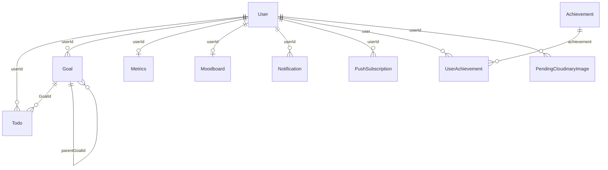

# Documentación técnica — Nuri Task API

Documento de referencia para entender el backend de punta a punta: qué resuelve, cómo está armado, por qué se tomaron ciertas decisiones y dónde buscar cada cosa. Está verificado contra el código del repositorio, no contra resúmenes desactualizados.

**Repositorio:** [github.com/leo2143/nuri-task-api](https://github.com/leo2143/nuri-task-api)  
**API en producción:** https://nuri-task-api.vercel.app  
**Swagger:** https://nuri-task-api.vercel.app/api-docs  
**Frontend que lo consume:** [nuri-task-app](https://github.com/leo2143/nuri-task-app)

---

## Índice

1. [Qué es Nuri Task y qué resuelve](#1-qué-es-nuri-task-y-qué-resuelve)
2. [Cómo levantarlo](#2-cómo-levantarlo)
3. [Arquitectura en capas](#3-arquitectura-en-capas)
4. [Modelo de datos](#4-modelo-de-datos)
5. [Catálogo de la API](#5-catálogo-de-la-api)
6. [Validación con Zod y DTOs](#6-validación-con-zod-y-dtos)
7. [Autenticación y seguridad](#7-autenticación-y-seguridad)
8. [Reglas de negocio](#8-reglas-de-negocio)
9. [Integraciones externas](#9-integraciones-externas)
10. [Despliegue y operación](#10-despliegue-y-operación)
11. [Calidad y resiliencia](#11-calidad-y-resiliencia)
12. [Deuda técnica y limitaciones](#12-deuda-técnica-y-limitaciones)
13. [Mapa de archivos](#13-mapa-de-archivos)

---

## 1. Qué es Nuri Task y qué resuelve

Nuri Task es una API REST para una app de productividad con acompañamiento emocional. No es solo un CRUD de listas: el dominio gira alrededor de **formar hábitos** (tareas diarias), **objetivos de largo plazo** (metas y submetas) y **motivación** (rachas, logros, moodboard, notificaciones).

El backend es el dueño de la verdad: valida, persiste, aplica reglas (por ejemplo, una tarea confirmada no se puede editar) y habla con servicios externos (email, MercadoPago, Cloudinary, Web Push).

### Glosario de dominio

| Concepto | Qué es |
|----------|--------|
| **Usuario** | Persona con email. Puede registrarse con contraseña o con Google. Tiene rol `isAdmin` y un objeto `subscription`. |
| **Tarea (Todo)** | Acción concreta. Prioridad `low` / `medium` / `high`, fecha opcional, comentarios. Puede vincularse a una meta. |
| **Tarea bloqueada (`isLocked`)** | Al marcarse completada, queda irreversible para el usuario. Evita “descompletar” para inflar rachas o logros. |
| **Meta (Goal)** | Objetivo de más alcance. Estados: `active`, `paused`, `completed`. Puede tener **submetas** (`parentGoalId`). |
| **Progreso de meta** | Porcentaje 0–100 calculado **solo con las tareas** de esa meta (`completedTasks / totalTasks`). Las submetas no entran en la fórmula. |
| **Racha (streak)** | Días locales consecutivos con al menos una tarea o una meta completada. Vive en el documento `Metrics` del usuario y se mide con claves de día `YYYY-MM-DD`. |
| **Logro (Achievement)** | Plantilla global (admin). El progreso por usuario está en `UserAchievement`. Se dispara por eventos (`task:completed`, `goal:completed`, `task:goal-changed`, `streak:updated`) y puede exigir condiciones configurables por el admin. |
| **Tier de logro** | `basic` (todos) o `premium` (visible para free, pero no accesible). |
| **Moodboard** | Tablero 1:1 de imágenes inspiracionales. Requiere suscripción activa (o admin). |
| **Premium** | `subscription.isActive === true` (vía MercadoPago o seteo admin). Desbloquea moodboard, dashboard de métricas y metas ilimitadas. El plan free permite **2 metas**. |
| **Notificación in-app** | Registro en Mongo. Tipos: vencimiento, riesgo de racha, inactividad, subida de racha, logro completado. |
| **Push** | Misma información enviada al navegador vía Web Push (VAPID). |
| **Onboarding** | Flag `onboardingCompleted`. El front redirige hasta que el usuario lo marca. |
| **Email verificado** | `emailVerified`. Sin esto el front no deja entrar a la app. |

### Stack (versión del `package.json`)

| Pieza | Tecnología | Para qué |
|-------|------------|----------|
| Runtime | Node.js 20+, ESM (`"type": "module"`) | Módulos nativos, top-level await |
| HTTP | Express 5.1 | Ruteo y middleware |
| Base de datos | MongoDB + Mongoose 8.18 | Documentos, índices, query middleware |
| Validación | Zod 3.25 | Contratos de entrada (DTOs) |
| Auth | jsonwebtoken + bcrypt + cookie-parser | Sesión en cookie HttpOnly |
| Email | Nodemailer 7 | Verificación y reset |
| OAuth | google-auth-library | Login con Google |
| Imágenes | cloudinary | Perfil, moodboard, logros |
| Pagos | API REST de MercadoPago | Preapproval mensual |
| Push | web-push | Notificaciones del navegador |
| Rate limit | express-rate-limit | Frenar fuerza bruta en auth |
| Serverless | @vercel/functions (`waitUntil`) | Trabajo post-respuesta en Vercel |

---

## 2. Cómo levantarlo

### Requisitos

- Node.js 20+
- npm 10+
- MongoDB 6+ (local o [Atlas](https://www.mongodb.com/cloud/atlas))

### Pasos

```bash
git clone https://github.com/leo2143/nuri-task-api.git
cd nuri-task-api
npm install
cp .env.example .env
# Completar .env (JWT_SECRET y MONGO_URI son obligatorios)
npm start
```

El servidor local escucha en `PORT` (default `3000`). Swagger: `http://localhost:3000/api-docs`.

`npm install` corre `postinstall` → regenera `swagger_output.json`.

### Scripts

| Script | Qué hace |
|--------|----------|
| `npm start` | `node index.js` — servidor local |
| `npm run dev` / `npm run swagger` | Regenera Swagger y, si no está en Vercel, levanta la app |
| `npm run lint` | ESLint |
| `npm run format` / `format:check` | Prettier |
| `npm run docs` / `docs:serve` | JSDoc HTML |
| `npm test` | Placeholder: no hay tests automatizados |

### Variables de entorno

Solo nombres y propósito. Los valores reales van en `.env` (nunca en el repo).

| Variable | Obligatoria | Propósito |
|----------|-------------|-----------|
| `MONGO_URI` | Sí (persistencia) | Conexión MongoDB |
| `JWT_SECRET` | Sí (el boot falla si falta) | Firma y verificación del JWT |
| `PORT` | No en Vercel | Puerto local (default 3000) |
| `NODE_ENV` | No | `development` cambia cookies y expone `devToken` en reset |
| `FRONTEND_URL` | Recomendada | Origin extra de CORS + links en emails |
| `API_URL` | Recomendada | URL pública (back-url de MercadoPago) |
| `EMAIL_SERVICE` / `EMAIL_HOST` / `EMAIL_PORT` / `EMAIL_SECURE` | No | SMTP; default Gmail |
| `EMAIL_USER` / `EMAIL_PASSWORD` | Para mails | Usuario SMTP y **app password** de Gmail (no la clave de la cuenta) |
| `EMAIL_FROM_NAME` | No | Nombre del remitente |
| `GOOGLE_CLIENT_ID` / `GOOGLE_CLIENT_SECRET` | Login Google | OAuth |
| `MP_ACCESS_TOKEN` | Suscripciones | API MercadoPago |
| `MP_WEBHOOK_SECRET` | Fail-closed | HMAC del webhook; sin esto la firma no valida |
| `MP_SUBSCRIPTION_AMOUNT` | No | Monto (default 15) |
| `CRON_SECRET` | Fail-closed | Bearer de `/api/cron/*` |
| `VAPID_PUBLIC_KEY` / `VAPID_PRIVATE_KEY` / `VAPID_EMAIL` | Push | Web Push |
| `CLOUDINARY_CLOUD_NAME` / `CLOUDINARY_API_KEY` / `CLOUDINARY_API_SECRET` | Imágenes | Cloudinary |

Vercel inyecta `VERCEL`, `VERCEL_URL`, `VERCEL_PROJECT_PRODUCTION_URL`. No hace falta ponerlas en `.env`.

### Datos de prueba

En `resources/moongo-scripts/` hay JSON para `mongoimport` (users, todos, goals, metrics, achievements). Son fixtures locales, no runtime. Sonar los excluye del análisis (`.sonarcloud.properties`).

---

## 3. Arquitectura en capas

```
Request HTTP
    → middlewares (Mongo, JSON, cookie, CORS, auth)
    → controllers/<dominio>/routes.js   (path + middlewares de ruta)
    → controllers/<dominio>/*Controller.js  (HTTP fino)
    → services/*Service.js              (reglas de negocio)
    → models/dtos + models/*Model.js    (validación + persistencia)
    → MongoDB
```

**Por qué controllers finos.** El controller no decide si una tarea se bloquea o si hay que compensar un preapproval. Solo traduce HTTP ↔ servicio y escribe `res.status(result.status).json(result)`. Así se puede testear el dominio sin Express y no se mezcla “cómo llegó el request” con “qué significa en el negocio”.

**Por qué ESM.** `"type": "module"` permite `import`/`export` nativo y `await` en `index.js`. Encaja con Express 5 y con el modelo serverless (exportar `app` sin `listen`).

### Arranque local vs Vercel

[`index.js`](index.js):

1. Carga dotenv.
2. Crea la app (`createServer`) y registra rutas (`setupRoutes`).
3. Si `VERCEL !== '1'`: conecta Mongo una vez y hace `listen`.
4. Si está en Vercel: **no** escucha. Exporta `app` y `config.maxDuration = 60`.

En serverless cada request es una invocación. Mongo no puede “quedarse conectado” como en un proceso largo, pero reconectar en cada hit es caro. [`server-config.js`](server-config.js) cachea la conexión y la promise:

- Si ya hay `cachedConnection`, la reusa.
- Si hay un `connectPromise` en curso (cold start concurrente), todos esperan la misma promise.
- Un middleware global hace `await connectMongo()` **antes** de cada request en Vercel.

**Alternativa descartada:** un `listen` permanente. En Vercel no hay proceso 24/7; el rewrite `/(.*) → /index.js` monta Express por invocación.

### Orden del middleware (global)

Definido en `createServer()`:

1. Validar que exista `JWT_SECRET` (si no, la app no arranca).
2. `app.disable('x-powered-by')` — no filtrar la versión de Express.
3. `trust proxy = 1` — IP real detrás de Vercel (rate limit).
4. Conectar Mongo.
5. `express.json()`.
6. `cookieParser()` — lee `nuri_auth`.
7. CORS con allowlist exacta (`credentials: true`). Requests **sin** `Origin` se aceptan (cron, curl, webhook).
8. `express.static(public/)`.

Después, en `setupRoutes()`: rutas de dominio → Swagger estático → `notFoundHandler` → `errorHandler`.

### Cómo se registran las rutas

No hay un `Router` de Express por dominio en `routes/`. El orquestador es [`routes/routes.js`](routes/routes.js): llama `setup*Routes(app)` de cada `controllers/<dominio>/routes.js`. La definición del path vive junto al controller. El orden importa solo para no pisar rutas genéricas (`/:id`) con rutas fijas (`/catalogs`).

### Librerías de esta capa y por qué

| Librería | Problema | Por qué esta |
|----------|----------|--------------|
| Express 5 | Servir HTTP | Estándar, middleware composable, funciona exportando `app` a Vercel |
| cors | El front está en otro origin | Allowlist exacta + cookies. Un `*` con credentials no funciona |
| cookie-parser | JWT en cookie, no solo Bearer | El SPA no puede leer HttpOnly; el browser la manda solo |
| dotenv | Config por entorno | Local. En Vercel las vars las pone la plataforma |

---

## 4. Modelo de datos

MongoDB guarda documentos. Mongoose define forma, defaults, índices y (en Todo/Goal) un filtro automático de borrados.



**Decisión:** referencias (`ObjectId`) en vez de embeber todo en el usuario. Un usuario puede tener muchas tareas y notificaciones; embeber reventaría el documento de 16 MB y haría dolorosos los listados paginados.

### `users`

| Campo | Tipo | Notas |
|-------|------|-------|
| name, email | String | email unique |
| password | String \| null | Hash bcrypt; null en cuentas solo-Google |
| googleId | String sparse unique | OAuth |
| isAdmin | Boolean | Bypass de premium y rutas admin |
| subscription.isActive / startDate / endDate / mercadoPagoId | | MP actualiza `isActive`; admin puede setear `endDate` |
| resetPasswordToken / Expires | | SHA-256 del token; 1 h |
| emailVerificationToken / Expires | | Igual |
| emailVerified, onboardingCompleted | Boolean | Gates del front |
| profileImageUrl | String \| null | Cloudinary |

Timestamps automáticos. Índice sparse en `subscription.mercadoPagoId` (el webhook busca por ese id).

### `todos`

| Campo | Tipo | Notas |
|-------|------|-------|
| title, description | String | |
| comments[] | `{ text, author, date }` | |
| completed, isLocked | Boolean | Al completar → `isLocked = true` |
| completedAt | Date | null | Hora del servidor en que se reclamó la completación. Las tareas legacy y las pendientes tienen `null` (sin backfill) |
| userId, GoalId | ObjectId | GoalId puede ser null |
| priority | enum | default `medium` |
| dueDate | Date \| null | Lo usa el cron de vencimientos |
| deleted_at | Date \| null | Soft delete |

Índices: `{ userId, deleted_at, _id }`, `{ completed, deleted_at, dueDate }`, `{ GoalId }`.

**Soft delete.** Un `pre(/^find/)` y un `pre('countDocuments')` ocultan documentos con `deleted_at` salvo que la query ponga `include_deleted: true`. El usuario “borra” sin perder historial para auditoría o rollback. Hard delete solo al borrar la cuenta.

### `goals`

| Campo | Tipo | Notas |
|-------|------|-------|
| title, description, reason | String | |
| status | `active` \| `paused` \| `completed` | |
| priority, dueDate | | |
| parentGoalId | ObjectId \| null | Submeta |
| totalSubGoals / completedSubGoals | Number | Desnormalizado |
| totalTasks / completedTasks / progress | Number | `progress` = % de tareas |
| userId, deleted_at | | Soft delete igual que todos |

Métodos de instancia: `updateTaskCount()`, `updateSubGoalCount()`. Virtual `calculatedProgress`.

**Por qué desnormalizar contadores.** Recalcular en cada listado con un `$lookup` + `$count` es más lento y más difícil de paginar. Se actualizan cuando cambia una tarea o una submeta (`runWithOneRetry` si falla el primer intento).

### `achievements` y `userachievements`

Plantilla global (admin): `title`, `description`, `targetCount`, `type`, `triggerEvent`, `conditions`, `reward`, `tier` (`basic|premium`), `isActive`, `imageUrl`. Los tipos, los eventos y las condiciones que admite cada evento están en un solo lugar: `models/achievementCatalog.js` (lo consumen el modelo, los DTOs, el servicio y `GET /api/achievements/catalog`).

Progreso por usuario: `{ user, achievement }` único, `currentCount`, `window { key, count }` (solo logros con `sameWindow`), `status` (`locked|unlocked|completed`), fechas. Índice `{ triggerEvent, isActive }` en plantillas para el `processEvent`.

`type: 'metric'` existe en el schema pero **no hay** `triggerEvent` de métricas en runtime. Solo corren los cuatro eventos del catálogo.

### `metrics` (una fila por usuario)

`currentStreak`, `bestStreak`, `totalTasksCompleted`, `totalGoalsCompleted`, `lastActivityDay` (clave de día local `YYYY-MM-DD`), `lastActivityDate` (instante), `history[]` (una fila por día local activo: `date`, `day`, `tasksCompleted`, `goalsCompleted`). Unique en `userId`, índice en `lastActivityDay`.

La racha vive **acá**. Ya no existe un modelo `Streak` aparte.

### Otras colecciones

| Colección | Rol |
|-----------|-----|
| `moodboards` | 1:1 con usuario (`userId` unique), array de imágenes |
| `notifications` | Inbox in-app |
| `pushsubscriptions` | `{ userId, endpoint, keys }` unique por par usuario+endpoint |
| `pendingcloudinaryimages` | URL + publicId; TTL Mongo 3600 s |
| `streaks` | Sin modelo: es la colección legacy del `streaksModel.js` eliminado. Se borra con `s2-metrics-day-keys.js --step=drop-legacy-streaks` |

`models/responseModel.js` y `models/dtos/**` **no** son colecciones: son contratos HTTP y de validación.

---

## 5. Catálogo de la API

### Envelope de respuesta

Todas las respuestas de negocio (salvo webhook y algún catch viejo) usan clases de [`models/responseModel.js`](models/responseModel.js):

```json
{ "success": true, "status": 200, "message": "...", "data": {}, "meta": null }
```

| Clase | HTTP | success |
|-------|------|---------|
| SuccessResponseModel | 200 (configurable) | true |
| CreatedResponseModel | 201 | true |
| NoContentResponseModel | 204 | true |
| BadRequestResponseModel | 400 | false |
| UnauthorizedResponseModel | 401 | false |
| ForbiddenResponseModel | 403 | false |
| NotFoundResponseModel | 404 | false |
| ConflictResponseModel | 409 | false |
| ErrorResponseModel | 500 default | false |

El controller hace `res.status(result.status).json(result)`. El front tipa esto en `IApiResponse.ts`.

**Por qué un envelope y no el body crudo.** El cliente siempre sabe si falló por `success` + `status`, no por adivinar la forma. `meta` lleva paginación sin mezclarla con el array.

### Paginación por cursor

No se usa `skip/limit` (página 3 = escanear 2 páginas). Se usa el `_id` del último ítem visto:

1. El cliente manda `cursor` (ObjectId) y `limit` (1–100, default 10).
2. El servidor pide `limit + 1` documentos.
3. Si vino uno de más → `hasMore: true`, se recorta, `nextCursor` = `_id` del último visible.
4. El siguiente request usa ese cursor: `_id < cursor` (desc) o `_id > cursor` (asc).

`meta`: `{ count, nextCursor, hasMore, limit }`.

**Por qué cursor y no offset.** En un feed que crece, `skip` se pone lento y puede saltar o repetir ítems si alguien inserta en el medio. ObjectId es monotónico a efectos prácticos.

### Auth en la tabla

| Código | Significado |
|--------|-------------|
| — | Público |
| RL-IP | Rate limit por IP |
| RL-IP+email | Rate limit por IP y por email del body |
| JWT | Cookie `nuri_auth` o `Authorization: Bearer` |
| Admin | JWT + `isAdmin` en DB |
| JWT+Sub | JWT + suscripción activa (admin bypasea) |
| Cron | `Authorization: Bearer CRON_SECRET` |
| MP-HMAC | Firma MercadoPago |

### Endpoints

| Método | Path | Auth | Controller |
|--------|------|------|------------|
| GET | `/health` | — | healthCheck |
| GET | `/` | — | `public/index.html` |
| GET | `/api-docs` | — | redirect a Swagger UI |
| GET | `/api-docs/swagger.json` | — | spec |
| POST | `/api/auth/google` | RL-IP | GoogleAuthController.googleLogin |
| POST | `/api/users/login` | RL-IP+email | UsersController.loginUser |
| POST | `/api/users/logout` | — | UsersController.logout |
| POST | `/api/users` | RL-IP+email | UsersController.createUser |
| POST | `/api/admin/users` | Admin | UsersController.createAdminUser |
| POST | `/api/users/forgot-password` | RL-IP+email | UsersController.forgotPassword |
| GET | `/api/users/verify-reset-token/:token` | RL-IP | UsersController.verifyResetToken |
| POST | `/api/users/reset-password` | RL-IP | UsersController.resetPassword |
| PUT | `/api/users/change-password` | JWT | UsersController.changePassword |
| GET | `/api/user/profile` | JWT | UsersController.getProfile |
| PUT | `/api/user/timezone` | JWT | UsersController.updateTimezone |
| PUT | `/api/user/profile-image` | JWT | UsersController.updateProfileImage |
| DELETE | `/api/user/profile-image` | JWT | UsersController.deleteProfileImage |
| PUT | `/api/user/onboarding-complete` | JWT | UsersController.completeOnboarding |
| GET | `/api/users/verify-email/:token` | — | UsersController.verifyEmail |
| POST | `/api/users/resend-verification` | RL-IP+email | UsersController.resendVerification |
| PUT | `/api/users/set-password` | JWT | UsersController.setPassword |
| GET | `/api/users` | Admin | UsersController.getAllUsers |
| GET | `/api/users/:id` | Admin | UsersController.getUserById |
| PUT | `/api/users/:id` | Admin | UsersController.updateUser |
| PUT | `/api/admin/users/:id` | Admin | UsersController.updateAdminUser |
| DELETE | `/api/users/:id` | Admin | UsersController.deleteUser |
| PUT | `/api/admin/users/:id/reset-password` | Admin | UsersController.resetUserPassword |
| GET | `/api/todos` | JWT | TodoController.getAllTodos |
| GET | `/api/todos/completed` | JWT | TodoController.getCompletedTodos |
| GET | `/api/todos/pending` | JWT | TodoController.getPendingTodos |
| GET | `/api/todos/:id` | JWT | TodoController.getTodoById |
| GET | `/api/goals/:goalId/todos` | JWT | TodoController.getTodosByGoalId |
| POST | `/api/todos` | JWT | TodoController.createTodo |
| PUT | `/api/todos/:id` | JWT | TodoController.updateTodo |
| PATCH | `/api/todos/:id/state` | JWT | TodoController.updateTodoState |
| DELETE | `/api/todos/:id` | JWT | TodoController.deleteTodo |
| POST | `/api/todos/:id/comments` | JWT | TodoController.addCommentToTodo |
| GET | `/api/goals` | JWT | GoalController.getAllGoals |
| GET | `/api/goals/catalogs` | JWT | GoalController.getCatalogGoals |
| GET | `/api/goals/active` | JWT | GoalController.getActiveGoals |
| GET | `/api/goals/paused` | JWT | GoalController.getPausedGoals |
| GET | `/api/goals/completed` | JWT | GoalController.getCompletedGoals |
| GET | `/api/goals/:id` | JWT | GoalController.getGoalById |
| POST | `/api/goals` | JWT | GoalController.createGoal |
| PUT | `/api/goals/:id` | JWT | GoalController.updateGoal |
| DELETE | `/api/goals/:id` | JWT | GoalController.deleteGoal |
| GET | `/api/goals/:id/parent` | JWT | GoalController.getGoalsByParentGoalId |
| PATCH | `/api/goals/:id/subgoals` | JWT | GoalController.addSubgoal |
| PATCH | `/api/goals/:id/status` | JWT | GoalController.updateGoalStatus |
| POST | `/api/goals/:id/reopen` | JWT | GoalController.reopenGoal |
| GET | `/api/metrics` | JWT+Sub | MetricsController.getAllMetrics |
| GET | `/api/metrics/dashboard` | JWT+Sub | MetricsController.getMetricDashboard |
| GET | `/api/metrics/current-streak` | JWT | MetricsController.getCurrentStreak |
| POST | `/api/metrics/check-streaks` | JWT | MetricsController.checkAndUpdateStreaks |
| GET | `/api/admin/dashboard` | Admin | MetricsController.getAdminDashboardStats |
| GET | `/api/moodboard` | JWT+Sub | MoodboardController.getMoodboard |
| PUT | `/api/moodboard` | JWT+Sub | MoodboardController.updateMoodboard |
| POST | `/api/moodboard/images` | JWT+Sub | MoodboardController.addImage |
| DELETE | `/api/moodboard/images/:imageId` | JWT+Sub | MoodboardController.removeImage |
| PUT | `/api/moodboard/images/:imageId` | JWT+Sub | MoodboardController.updateImage |
| GET | `/api/achievements` | Admin | AchievementController.getAllAchievements |
| GET | `/api/achievements/stats` | Admin | AchievementController.getAchievementStats |
| GET | `/api/achievements/catalog` | Admin | AchievementController.getAchievementCatalog |
| GET | `/api/achievements/type/:type` | Admin | AchievementController.getAchievementsByType |
| GET | `/api/achievements/:id` | Admin | AchievementController.getAchievementById |
| GET | `/api/achievements/:id/in-progress-count` | Admin | AchievementController.getInProgressCount |
| POST | `/api/achievements` | Admin | AchievementController.createAchievement |
| PUT | `/api/achievements/:id` | Admin | AchievementController.updateAchievement |
| DELETE | `/api/achievements/:id` | Admin | AchievementController.deleteAchievement |
| DELETE | `/api/achievements/users/:userId/achievements/:achievementId` | Admin | UserAchievementController.resetProgress |
| GET | `/api/user/achievements` | JWT | UserAchievementController.getAllAchievementsWithProgress |
| GET | `/api/user/achievements/stats` | JWT | UserAchievementController.getUserStats |
| GET | `/api/user/achievements/:id/progress` | JWT | UserAchievementController.getUserAchievementProgress |
| POST | `/api/cloudinary/pending` | JWT | CloudinaryController.registerPendingImage |
| DELETE | `/api/cloudinary/image` | JWT | CloudinaryController.deleteImage |
| POST | `/api/push/subscribe` | JWT | PushController.subscribe |
| DELETE | `/api/push/unsubscribe` | JWT | PushController.unsubscribe |
| GET | `/api/push/vapid-key` | — | PushController.getVapidKey |
| GET | `/api/cron/dispatch` | Cron | CronDispatcher.dispatch (`?h=0..23`, `dryRun=1` fuera de producción) |
| GET | `/api/cron/:jobName` | Cron | CronController.run (corrida manual; jobs en `controllers/cron/jobRegistry.js`, `?timezone=`) |
| GET | `/api/notifications/unread-count` | JWT | NotificationController.getUnreadCount |
| GET | `/api/notifications` | JWT | NotificationController.getAll |
| PATCH | `/api/notifications/read-all` | JWT | NotificationController.markAllAsRead |
| PATCH | `/api/notifications/:id/read` | JWT | NotificationController.markAsRead |
| POST | `/api/subscription/activate` | JWT | SubscriptionController.activate |
| POST | `/api/subscription/cancel` | JWT | SubscriptionController.cancel |
| GET | `/api/subscription/status` | JWT | SubscriptionController.getStatus |
| POST | `/api/webhooks/mercadopago` | MP-HMAC | WebhookController.mercadoPago |

Infra extra: `/health`, `/`, `/swagger-ui/`.

Swagger (`swagger-autogen`) escanea todos, users, goals, metrics, moodboard, achievements, cloudinary y auth. **No** regenera comentarios de push, cron, notifications, subscription ni webhooks: existen en runtime, pueden faltar o quedar incompletos en el JSON.

---

## 6. Validación con Zod y DTOs

### El problema

Express no valida el body. Si el servicio lee `req.body.email` crudo, un número o un objeto termina en Mongo o en un crash. Validar “a mano” con `if` se copia en cada endpoint y se pudre.

### La decisión

Cada entrada tiene una **clase DTO** con:

1. `constructor` que copia/normaliza campos.
2. `static schema` — objeto Zod.
3. `validate()` — `validateZod(schema, data)` → `{ isValid, errors, data }`.
4. Opcional: `toPlainObject()`, `toMongoQuery()`, `toMongoSort()`.

El servicio hace `new TodoFilterDto(filters)` → `validate()` → si falla, `BadRequestResponseModel(errors.join(', '))`. El controller no conoce Zod.

**Por qué Zod y no Joi / class-validator.** Zod es TypeScript-first, `safeParse` no tira, y los mensajes se mapean a un array plano. Encaja con clases ESM sin decorators. Docs: [zod.dev](https://zod.dev/).

**Por qué no `z.coerce.boolean()`.** `Boolean("false")` es `true`. Por eso `queryBooleanField` acepta `boolean | 'true' | 'false'` y `toQueryBoolean` solo trata como true esos dos valores.

### Piezas reutilizables (`models/dtos/zodHelpers.js`)

| Export | Uso |
|--------|-----|
| `emailField` | `z.string().email(...)` |
| `passwordField` | Mínimo 6 (registro, reset) |
| `loginPasswordField` | Solo requerida (login) |
| `tokenField`, `objectIdField` | Tokens y IDs Mongo |
| `queryBooleanField` + `toQueryBoolean` | Query strings |
| `priorityField`, `goalStatusField`, `sortOrderField` | Enums |
| `titleField` / `optionalTitleField` | 3–50 chars |
| `optionalDueDateField` | Fecha límite flotante opcional/nullable, solo valida el formato |
| `dueDateNotPastField({ todayYmd })` | Lo anterior + no fechas en el pasado (día calendario). Solo DTOs de creación |
| `imageUrlField` / `cloudinaryImageUrlField` | Delegados a `ValidationHelpers` |
| `validateZod` / `mergeValidations` | Adaptador y unión de errores |
| `paginationSchema` | cursor + limit 1–100 |

Los Filter DTO **extienden** `PaginationDto` y hacen `mergeValidations(super.validate(), validateZod(...))`.

### Ejemplo end-to-end: `GET /api/todos?completed=true&limit=10`

1. `validateToken` pone `req.userId`.
2. `TodoController.getAllTodos` pasa `req.query` + `userId` al servicio.
3. `new TodoFilterDto(query)` → Zod: `completed` puede ser `'true'`.
4. `toMongoQuery()` → `{ completed: true }` vía `toQueryBoolean`.
5. `toMongoSort()` → `{ _id: -1 }` (default desc).
6. `Todo.find({ userId, ...query }).sort(sort).limit(11)` — el middleware de Mongoose agrega `deleted_at: null`.
7. `processPaginationResults` arma `meta`.
8. `SuccessResponseModel(todos, mensaje, 200, meta)`.

Si `limit=999`, Zod falla antes de tocar Mongo.

---

## 7. Autenticación y seguridad

### JWT + cookie `nuri_auth`

El token dura 24 h. Payload: `userId`, `email`, `name`, `isAdmin`. Se firma con `JWT_SECRET` (sin fallback: si falta, `createServer` tira).

**Problema.** Un JWT en `localStorage` lo lee cualquier XSS. Un JWT solo en memoria se pierde al recargar. Un JWT en cookie HttpOnly el JS no lo ve; el browser lo manda solo a orígenes permitidos.

**Decisión.** Cookie HttpOnly `nuri_auth` + fallback `Authorization: Bearer` (Postman, cron internos, clientes viejos). Login, Google y verify-email llaman `attachAuthCookie`: setean la cookie y **sacan** `token` del JSON.

| Atributo | Local (`NODE_ENV=development`) | Prod / `VERCEL=1` |
|----------|--------------------------------|-------------------|
| HttpOnly | true | true |
| Path | `/` | `/` |
| maxAge | 24 h | 24 h |
| Secure | false | true |
| SameSite | `Lax` | `None` (front y API en dominios distintos) |

Logout: `clearAuthCookie`. El front además limpia su caché de usuario.

### Contraseñas

- bcrypt, 10 rounds.
- Login: si el usuario **no existe**, igual se corre `verifyDummyPassword` contra un hash generado al cargar el módulo (`bcrypt.hashSync('nuri-timing-dummy', 10)`). El atacante no distingue “no existe” de “mala clave” por el tiempo de respuesta. El mensaje es siempre “Credenciales inválidas”.
- Cuentas solo-Google: mensaje distinto (no es enumeración de email/password; es un camino de auth distinto).

**Por qué no devolver “el email no existe”.** Facilita enumerar cuentas. Ticket de hardening explícito.

### Tokens de email y reset

32 bytes aleatorios → se guarda **SHA-256**, no el token plano. Expiran en 1 h. Forgot-password y resend-verification responden genérico (no revelan si el email existe). Cooldown de reenvío: 60 s.

En `NODE_ENV=development` el reset puede devolver `devToken` para no depender del mail.

### Google OAuth

`POST /api/auth/google` con `{ code }`. `GoogleAuthService` canjea el code, verifica el id_token, exige `email_verified`, vincula `googleId`. Si el moodboard no se puede crear, se borra el usuario (compensación).

### Rate limiting

10 intentos / 15 min por IP. En login, registro, forgot y resend hay un segundo limiter por email del body. Reset y Google: solo IP.

### CORS

Allowlist exacta: localhost 3000/5173, 127.0.0.1:5173, URLs de prod, más `FRONTEND_URL` sin slash final. Nada de `includes(substring)`.

### Otros bordes

| Pieza | Cómo |
|-------|------|
| Cron | Bearer = `CRON_SECRET`. Sin secret → 401 |
| Webhook MP | HMAC SHA-256 (`id;request-id;ts`) con `MP_WEBHOOK_SECRET` |
| x-powered-by | Deshabilitado |
| trust proxy | 1, para no rate-limitar la IP de Vercel |

---

## 8. Reglas de negocio

### Progreso de una meta

`Goal.updateTaskCount()` cuenta los `Todo` con ese `GoalId` (el soft delete ya los oculta). `progress = round(completedTasks / totalTasks * 100)`, o 0 si no hay tareas. **Las submetas no suman.**

Los contadores del padre (`totalSubGoals`, `completedSubGoals`) se actualizan al crear/mover/completar una submeta.

### Jerarquía

`parentGoalId` apunta a otra meta del mismo usuario. Ninguna vinculación puede formar un ciclo (una meta no puede colgar de sí misma ni de uno de sus descendientes): la API responde **409** `No se pueden vincular estas metas: una ya forma parte de la otra.` antes de escribir. Una meta **completada** sí puede colgarse de un padre activo; el padre nunca se autocompleta por eso. Al borrar una meta: soft delete de la meta y de sus todos; **no** se borran ni reparentan las hijas (quedan con un padre “invisible”). Si falla el `save` de la meta, se revierte el `deleted_at` de los todos.

### Metas completadas (solo lectura) y reapertura

Una meta `completed` es de solo lectura para su contenido: la API responde **409** (`Esta meta ya está completada. Reabrila desde su detalle para sumarle tareas o submetas. Si no ves el botón, actualizá la app.`) antes de cualquier escritura cuando se intenta:

- crear una tarea en ella (`POST /api/todos` con su `GoalId`),
- mover una tarea pendiente hacia ella (`PUT /api/todos/:id` que cambia `GoalId`; editar otros campos de una tarea que ya vive en la meta sí se permite),
- agregarle una submeta (`POST /api/goals` con `parentGoalId`, `PATCH /api/goals/:id/subgoals`, o `PUT /api/goals/:id` que cambia el padre).

Editar título, descripción, fecha límite y prioridad de la meta sigue permitido. Mover, destildar o borrar tareas de una meta completada se rige por el bloqueo de tareas de abajo; borrar una submeta no deshace la completación.

**Reapertura explícita.** `POST /api/goals/:id/reopen` es la única forma de volver a `active`; `PATCH /api/goals/:id/status` y `PUT /api/goals/:id` con `status: active` sobre una meta completada delegan en la misma lógica. Reglas:

- Solo la meta del usuario (404 si no existe) y solo si está `completed` (409 si no; el segundo click de un doble click recibe 409).
- No toca métricas, racha ni logros, y completar de nuevo no vuelve a otorgarlos (`firstCompletedAt` se conserva; si era `null` en una meta legacy, se sella con la hora actual).
- Cascada: si los ancestros contiguos también están completados se reabren de afuera hacia adentro y la meta pedida al final, con actualización condicional por meta y contadores del padre refrescados en cada paso. La cadena se recorre con set de visitados y tope de profundidad 20, así un ciclo corrupto termina. Respuesta: `{ goal, cascaded }` con los IDs de los ancestros reabiertos.
- Cualquier otra transición desde `completed` (por ejemplo a `paused`) responde 400 `Esta meta ya está completada. Si querés retomarla, reabrila desde su detalle.`

**Selectores.** `GET /api/goals/catalogs` devuelve `{ id, title, status }` y acepta `excludeCompleted=true` (omite completadas) y `excludeRelatedTo=<goalId>` (omite esa meta, sus ancestros y sus descendientes; 400 si el id es inválido). Sin resultados responde `200` con lista vacía.

### Fechas y zonas horarias

Cada usuario tiene una zona IANA (`User.timezone`, con índice). Los usuarios sin zona resuelven a `DEFAULT_TIMEZONE` (`America/Argentina/Buenos_Aires`, "ART") hasta que la migración `s1-user-timezone` se la asigne. Toda la aritmética de fechas vive en `services/helpers/dateTime.js`.

- **Dos tipos de fecha que no se mezclan.** Los *instantes* (`createdAt`, `completedAt`) se resuelven en la zona del usuario. Las *fechas flotantes* (`dueDate`, guardada como `YYYY-MM-DDT12:00:00Z`) se comparan y muestran como su Y-M-D, sin corrimiento (`toFloatingYmd`, `getFloatingDayRange`).
- **Días como claves `YYYY-MM-DD`.** `toLocalYmd`, `addDaysToYmd` y `diffYmdDays` operan sobre claves de calendario, nunca dividen milisegundos por 24 h (un día local dura 23 o 25 horas en los cambios de horario). `getLocalDayRange(ymd, tz)` devuelve `[inicio, fin)` del día local; `zonedTimeToInstant` resuelve el desfase en el instante objetivo con dos pasadas, así soporta +05:30, +05:45, +14 y horas inexistentes por horario de verano.
- **Captura.** El APP manda la zona del dispositivo (`Intl.DateTimeFormat().resolvedOptions().timeZone`) en login, registro, Google y verify-email (`?timezone=`), y la re-sincroniza con `PUT /api/user/timezone` cuando difiere. No hay selección manual.
- **Validación leniente.** `isValidTimeZone` acepta solo zonas con región (letras primero y al menos una `/`), descarta `Etc/*`, `UTC`, `GMT`, `Z` y offsets (`+05:00`, `UTC+5`) y exige que `Intl` la reconozca. Un valor inválido se descarta, nunca falla la request y nunca pisa el valor guardado. `PUT /api/user/timezone` responde `{ timezone, updated }`; sin campo `timezone` devuelve 400.
- **Grafías y clave canónica.** Lo que se guarda es la forma que devuelve `Intl` (`canonicalTimeZone`), que depende del ICU del runtime (por ejemplo Kolkata puede resolverse como `Asia/Calcutta`), por eso nunca se escribe una grafía a mano y `package.json` fija `engines.node`. La clave canónica sirve **solo** para igualdad y agrupación, nunca como valor de consulta: las consultas por zona deben matchear todas las grafías guardadas. Dos grafías de una misma zona no disparan una re-sincronización.
- **Migración S1.** `node scripts/migrations/s1-user-timezone.js` (dry-run por defecto, `--apply` para escribir, `--restore`) asigna `DEFAULT_TIMEZONE` a los usuarios sin zona y asegura el índice; no reescribe grafías existentes y es idempotente. Orden de despliegue: API → `s1-user-timezone --apply` → APP.

### Fecha límite (`dueDate`)

Es una fecha flotante: el servidor la normaliza a `YYYY-MM-DDT12:00:00Z` con el día de calendario que mandó el cliente (primeros 10 caracteres, `normalizeDueDate`), nunca con el día UTC de un instante corrido. La validación de que no sea pasada vive solo en los DTOs de creación y compara días calendario contra el "hoy" del usuario (`getRequestTodayYmd` lee la zona de `req.userDoc`; un usuario sin zona usa la de producto). En los updates el servicio la valida únicamente si el valor entrante cambia respecto del guardado, con el mismo "hoy" del usuario, así editar el título de una meta o tarea ya vencida (por ejemplo una meta completada) funciona. Cambiar el estado de una meta nunca valida la fecha. Los jobs de notificación comparan la fecha límite como Y-M-D contra el día local del usuario (`getFloatingDayRange`), sin conversión de zona.

### Bloqueo de tareas

Completar una tarea es un **reclamo atómico**: un `findOneAndUpdate` condicionado a `completed: false, isLocked: false` que setea `completed`, `isLocked = true` y `completedAt` (hora del servidor). Solo el request que gana dispara métricas, racha y logros; los demás reciben éxito idempotente sin efectos. Repetir `completed: true` sobre una tarea ya completada (con o sin lock, incluidas las legacy con `completed: true, isLocked: false`) responde 200 sin efectos. `completed: false` sobre una tarea completada o locked responde 400. `POST /api/todos` y `PUT /api/todos/:id` ya no aceptan `completed` (las tareas nuevas nacen pendientes): la única vía para completar es `PATCH /api/todos/:id/state`, así el reclamo, `completedAt` y los eventos no se pueden saltear. `updateTodo` rechaza si la tarea ya está completada o locked. El usuario no puede borrar una confirmada; el admin sí. `PUT /api/goals/:id` devuelve `meta.events` igual que `PATCH /api/goals/:id/status` cuando la meta se completa.

Efectos al completar: contadores de meta → `MetricsService.writeTaskMetrics` (escritura atómica de métricas y racha) → `afterActivityMetrics` (notificación de racha y `processEvent('streak:updated')`) → `processEvent('task:completed')`.

### Logros

| Evento | Origen | Cómo cuenta |
|--------|--------|-------------|
| `task:completed` | `TodoService.updateTodoState` | suma 1 a `currentCount` |
| `goal:completed` | `GoalService.updateGoal` y `updateGoalStatus` | suma 1 |
| `task:goal-changed` | `TodoService.updateTodo` | suma 1, solo si la tarea pasa de una meta a OTRA (ambas no nulas y distintas); asignar o quitar la meta no cuenta. La respuesta lleva `meta.events` |
| `streak:updated` | `MetricsService.afterActivityMetrics` | asigna el valor actual de la racha |

`processEvent(trigger, userId, value, { occurredAt, startedAt, timezone })` evalúa las condiciones de cada logro activo con funciones puras (`services/achievementConditions.js`) y escribe el progreso con un pipeline de actualización atómico y upsert por `{ user, achievement }` (`services/helpers/achievementProgressPipeline.js`, driver nativo, MongoDB 4.2+). Solo cuenta el instante del SERVIDOR: `occurredAt` es el `completedAt` del reclamo de la tarea o el `firstCompletedAt` de la meta, nunca la hora de procesamiento ni una hora enviada por el cliente. La zona es la del usuario (se lee solo si alguna condición la necesita).

Condiciones (`conditions`, combinadas con AND; cada evento admite solo algunas, otras responden 400):

| Condición | Eventos | Significado |
|-----------|---------|-------------|
| `timeWindow { start, end }` | `task:completed`, `goal:completed`, `task:goal-changed` | Hora local `HH:mm` del instante del evento. El inicio se incluye y el fin NO; `start > end` cruza la medianoche (22:00-04:00); `start == end` se rechaza |
| `sameWindow` | `task:completed` | Booleano explícito. Con `targetCount > 1` el progreso cuenta solo eventos de la misma instancia de franja (clave = fecha local en que EMPEZÓ la franja; sin `timeWindow`, el día calendario local); otra instancia reinicia en 1. `currentCount` es el conteo de la instancia vigente |
| `maxDurationHours` | `goal:completed` | `firstCompletedAt - createdAt` en horas reales; reabrir y volver a cerrar no cambia la medida porque se usa el primer cierre |

Si `currentCount >= targetCount` → `completed` + notificación. La completada es un reclamo condicional por fila (`status != completed`): si dos eventos llegan a la vez solo uno completa y notifica. **Un logro completado nunca se revierte**: una racha que cae no lo baja, el pipeline congela las filas completadas (conservan `currentCount` y `window`) y un evento con clave de franja MÁS VIEJA que la guardada (evento tardío o fuera de orden) se ignora. El filtro del upsert nunca incluye `status`: con `status != completed` una fila completada no coincidiría y el insert chocaría con el índice único (E11000). Los premium se listan para free con `isAccessible: false`. Un error en `processEvent` **no** tumba el request.

**Edición por el admin** (`AchievementService.updateAchievement`): `PUT /api/achievements/:id` acepta `reward` y `conditions` (las condiciones se validan contra el evento resultante); el `tier` es **inmutable** (cualquier `tier` responde 400 "El tier de un logro no se puede cambiar. Desactivalo y creá uno nuevo."; `POST` sí lo acepta) y la actualización solo escribe los campos enviados. Los logros completados nunca se revocan. Si cambian el evento o las condiciones, el progreso en curso se reinicia (`currentCount 0`, `locked`, `window null`) en la MISMA transacción de Mongo que guarda la definición (`mongoose.startSession()` + `withTransaction`; requiere replica set, Atlas lo es; en un mongod suelto el PUT falla con 500 y se registra un error que lo explica, sin alternativa sin transacción): o quedan ambos cambios o ninguno, así no existe una definición nueva con el reinicio sin hacer ni reinicios a medias, y si la guarda optimista pierde (409) o algo falla el progreso queda intacto. La transacción solo se abre cuando cambia el evento o las condiciones; el resto de las ediciones (título, objetivo, etc.) son un único guardado con la misma guarda. Carrera aceptada: `processEvent` lee la definición y evalúa las condiciones antes de la transacción y escribe el progreso fuera de toda sesión, así que un evento evaluado con la definición vieja puede sumar progreso a una fila justo después del reinicio (ese avance se cuenta con las reglas viejas); los conflictos de escritura solo ordenan las escrituras, no hacen que el evento se reevalúe. La transacción está acotada para caber en el PUT (`maxDuration = 60`): no abre intentos nuevos pasados 40 s desde que empezó el PUT y el commit tiene `maxCommitTimeMS` de 10 s; si solo cambia `targetCount`, el progreso se conserva y completa (con notificación) a quien ya lo alcanzó por tandas de 200, en rondas de 10 filas (reclamo y notificación juntos, así nunca quedan filas reclamadas sin notificar), con un presupuesto de 40 s contado desde que empieza el PUT que se revisa en cada ronda (el PUT tiene `maxDuration = 60`), y la respuesta trae `meta.pendingCompletions` con las filas que quedaron sin completar (se completan con el próximo evento del usuario que cuente para ese logro); editar título, descripción, recompensa o imagen no toca el progreso. El guardado es optimista sobre `updatedAt`: si otra edición modificó el logro entre la lectura y la escritura, responde 409 y no se aplica nada (ni el guardado ni el reinicio). La finalización por objetivo más bajo corre después del commit, fuera de la transacción. La guarda de un logro sin `updatedAt` (importado o migrado) exige que siga sin tenerlo. Completar (por evento o al bajar el objetivo) reclama cada fila solo si sigue en el `targetCount` aplicado y, con `sameWindow`, en la misma franja con la que se la eligió: un PUT concurrente que reinicia el progreso la deja sin completar. Subir el objetivo mientras se completa no lo revalida el reclamo (compara contra el `targetCount` leído al seleccionar, no relee el logro ni usa la sesión de la edición): una fila puede completarse por debajo del objetivo recién subido (carrera aceptada; la completitud es irreversible) y solo se completan las filas que cumplían el objetivo leído en ese momento. `GET /api/achievements/:id/in-progress-count` devuelve `{ inProgressCount }` (usuarios con progreso sin completar); en logros con `sameWindow` solo cuenta (y solo completa al bajar el objetivo) a quien tiene guardada la franja vigente según su zona, porque `currentCount` conserva el conteo de la última franja y no se limpia para avisar al admin antes de guardar un cambio que reinicia. `isActive: false` saca el logro del catálogo del usuario y del evaluador; lo ganado se conserva y reactivar no otorga nada retroactivamente. `GET /api/achievements/catalog` devuelve `{ triggers: [{ triggerEvent, allowedConditions }], types, conditionKeys }`.

**Semillas y rollout (S5).** Canto de Gallo (tarea completada entre 05:00 y 08:00), Drácula (2 tareas en la misma franja 22:00-04:00), Meta Flash (meta cerrada dentro de 24 h) y Re-Ordenar (`task:goal-changed`) salen de `resources/moongo-scripts/achievements-data.json`. Orden: `mongoexport` de `userachievements` → `s5-achievements --step=seed --apply` (definiciones nuevas con `isActive: false`, así la API vieja no las otorga con la semántica vieja; antes de tocar nada guarda un backup con los logros originales y las filas de progreso que reinicia, y `--restore` devuelve ambos; si no hay nada que respaldar (ningún original ni fila por reiniciar y la corrida anterior no está pendiente, por ejemplo al repetir `seed` tras `activate`) no escribe backup y lo avisa en el log, para que un `--restore` sin `--file` no tome un backup vacío; el backup es acumulativo SOLO mientras la corrida anterior siga pendiente (tiene logros por activar, siguen inactivos y no se restauró): repetir `seed` en ese caso junta por `_id` los originales y por (usuario, logro) las filas del backup anterior con los nuevos, y gana el más antiguo, así `--restore` vuelve al estado previo al primer `seed` de la tanda; tras `activate` o tras un `--restore --apply` del seed (queda un archivo `.restored` junto al backup) el próximo `seed` escribe un backup nuevo solo con lo de su corrida, para que un `--restore` posterior no pise el progreso ganado desde entonces; el reinicio cubre el progreso en curso de los logros pendientes aunque el paso se repita tras una falla) → deploy de la API (anotar la hora) → `--step=reset --cutoff=<hora del deploy> --apply` (reinicia en silencio los completados anteriores; Meta Flash se conserva solo si hay una meta real cerrada dentro del límite) → `--step=reset-in-progress --cutoff=<hora del deploy> --apply` → `--step=activate --apply` (activa solo los logros que dejó inactivos el seed, leídos de su backup; uno que un admin desactivó no se toca; al terminar con `--apply` deja un archivo `.activated` junto al backup del seed y un `activate` repetido avisa que ya está consumido y no hace nada, así nunca reactiva lo que un admin desactivó después; tampoco activa un backup restaurado) → deploy del APP. El seed también corrige la `description` de los cuatro logros desde el JSON (sin desactivarlos ni reiniciar progreso si solo cambia el texto). Todos los pasos son idempotentes, dry-run por defecto y con `--restore` desde el backup; ninguno crea notificaciones.

Completar una meta por `PUT` o `PATCH` pasa por el mismo camino (`GoalService._handleGoalCompleted`): reclama `firstCompletedAt`, escribe las métricas con `writeGoalMetrics` y dispara el logro.

### Rachas

Un día activo es un día local en el que se completó una tarea **o** una meta (los jobs de recencia corren por zona desde el dispatcher y reciben el día local de cada grupo). Se compara con claves `YYYY-MM-DD` (`services/helpers/streakDays.js`), nunca con milisegundos. Primera actividad → racha 1; día siguiente consecutivo → +1 y posible `bestStreak`; hueco > 1 día → la próxima actividad reinicia en 1; mismo día, o un día anterior por cambio de huso → no cambia y `lastActivityDay` no retrocede.

La escritura es **una sola operación atómica** (`findOneAndUpdate` con pipeline de agregación, `services/helpers/metricsActivityPipeline.js`): actualiza racha, contadores, `lastActivityDay` y la fila de `history` del día, tanto para tareas como para metas. Solo se reintenta si el driver nunca envió la escritura (`runWriteRetryingOnlyIfUnsent`), así un reintento no cuenta dos veces. Requiere MongoDB 4.2 o superior.

No hay cron que reinicie rachas: la racha **efectiva** se calcula al leer (`getEffectiveStreak`: si pasó más de un día local desde `lastActivityDay`, es 0) y no escribe nada. `checkStreakExpiration` y el job `streak-reset` ya no existen.

**Rollout (S2).** Antes del deploy: `mongoexport` de `metrics`. Con el deploy: `node scripts/migrations/s2-metrics-day-keys.js --apply` (completa `lastActivityDay`, `history[].day` y `goalsCompleted` en ART y crea el índice; dry-run por defecto, idempotente, `--restore` desde backup). Sin la migración, una fila de historial sin `day` falla la validación y la próxima actividad cuenta como la primera. Después de verificar las rachas: `--step=drop-legacy-streaks --apply` borra la colección `streaks` con backup previo.

### Freemium

- Máximo **2 metas** si no es admin y no tiene suscripción (`FREE_GOALS_LIMIT`).
- Moodboard y `/api/metrics` + dashboard: `validateSubscription`.
- `/api/metrics/current-streak` es solo JWT (el Navbar muestra la racha sin paywall).

### Moodboard

Se crea en el registro (local o Google). Si falla, se borra el usuario. Imágenes: se persiste en Mongo **antes** de borrar la URL vieja en Cloudinary.

### Borrado de cuenta

`deleteUserOwnedDocuments` hace `deleteMany` paralelo (todos, metas, métricas, moodboard, notificaciones, push, userAchievements, pending images) y después `User.findByIdAndDelete`. Es hard delete.

---

## 9. Integraciones externas

### MercadoPago

1. `POST /api/subscription/activate` → `MercadoPagoService.createSubscription` (preapproval mensual ARS, monto `MP_SUBSCRIPTION_AMOUNT` o 15).
2. Se guarda `mercadoPagoId`. Se devuelve `init_point` (checkout).
3. Si Mongo falla después de crear el preapproval → se cancela en MP (no dejar cobros huérfanos).
4. El usuario paga. MP pega `POST /api/webhooks/mercadopago`.
5. HMAC válido → si `subscription_preapproval`, se mapea estado: `authorized` → `isActive true`; `pending|paused|cancelled` → false.

Cancelar: PUT en MP `cancelled` y se limpia el objeto `subscription` en el user.

### Cloudinary

El browser sube el binario **directo** a Cloudinary (preset unsigned en el front). El API solo:

- `POST /api/cloudinary/pending` — registra publicId; TTL 1 h. Si el usuario abandona el form, el pending caduca y no queda basura eterna.
- `DELETE /api/cloudinary/image` — solo URLs del cloud del proyecto, y preferentemente si están en pending o en un documento del user.

**Por qué no subir el archivo por Express.** Vercel tiene body chico y timeout; Cloudinary ya hace resize/CDN.

### Email (Nodemailer)

Verificación, reset y confirmación de cambio de clave. `FRONTEND_URL` (o `http://localhost:3000`) arma los links. Trailing slashes se recortan sin regex greedy. En prod el front es HTTPS; el default HTTP es solo local.

### Web Push

`web-push` + par VAPID. Payload JSON `{ title, body, icon, url }`. Un 410/404 del push service borra la suscripción. `GET /api/push/vapid-key` es público: la clave pública no es secreta.

`persistAndNotify`: escribe la notificación in-app y manda el push. En Vercel usa `waitUntil` para no cortar la función; en local hay un timeout de 1 s.

### Cron (Vercel)

Vercel Hobby solo admite crons diarios, así que [`vercel.json`](vercel.json) declara **24 crons** que apuntan a un único dispatcher: `0 H * * *` → `GET /api/cron/dispatch?h=H` para H = 0..23 (hora UTC). Cada tick decide qué jobs tocan en cada zona horaria. Hobby permite 100 crons por proyecto y puede disparar cada uno en cualquier minuto de su hora.

**Hora del tick.** `?h=H` del path (primaria); si falta, el header `x-vercel-cron-schedule` (`M H * * *`); si tampoco está, la hora UTC actual con un warning. Un `h` presente pero inválido responde 400 y no corre nada. El instante del tick es el último `H:00Z` anterior a `now`; un tick de más de 90 minutos se saltea (200).

**Qué corre.** Los jobs viven en [`jobRegistry.js`](controllers/cron/jobRegistry.js) con su `localHour` (jobs por zona) o `utcHour` (global). Un job corre para una zona solo si en ese instante la hora local de la zona **es exactamente** `localHour` (sin rangos ni recuperación: una hora salteada por el horario de verano no corre ese día). Los usuarios se agrupan por zona canónica, pero se consultan por **todas** las grafías guardadas; los usuarios sin zona y los valores que `Intl` rechaza caen en el grupo de producto (ART).

| Job | Hora local | Tipo |
|-----|-----------|------|
| `due-tasks` | 00:00 | `due_task` |
| `due-goals` | 01:00 | `due_goal` |
| `overdue-tasks` | 03:00 | `overdue_task` |
| `overdue-goals` | 06:00 | `overdue_goal` |
| `empty-goals` | 07:00 | `empty_goal` |
| `stalled-goals` | 08:00 | `stalled_goal` |
| `high-priority` | 09:00 | `high_priority_upcoming` |
| `high-priority-goals` | 10:00 | `high_priority_upcoming_goal` |
| `pause-too-long` | 11:00 | `pause_too_long` |
| `inactivity` | 12:00 | `inactivity` |
| `overdue-backlog` | 13:00 | `overdue_backlog` |
| `moodboard-nudge` | 14:00 | `moodboard_nudge` |
| `premium-nag` | 15:00 | `premium_nag` |
| `day-recap` | 19:00 | `day_recap` |
| `streak-risk` | 20:00 | `streak_risk` |
| `expire-notifications` | 02:00 UTC (global) | — |

Cada job de zona recibe `{ userIds, timezone, localDate, now }`: un lote de hasta 500 usuarios, la zona del grupo, el día local del tick y el instante. Las ventanas de "n días" se calculan con días de calendario locales (`getLocalDayRange(addDaysToYmd(localDate, -n), tz)`), no con múltiplos de 24 h. Cambiar un horario es cambiar un número en el registro.

**Ledger e idempotencia.** [`JobRun`](models/jobRunModel.js) tiene una fila por (`job`, `timezone`, `localDate`), única; `timezone` es la clave canónica o `global`. La unidad se reclama con un insert atómico; si ya existe, solo se retoma (una operación atómica, que suma 1 a `attempts`) si quedó `failed` o su `claimed` tiene más de 90 s y no agotó los 3 intentos. `done` o un reclamo reciente se saltean. TTL de 30 días. Esto protege de entregas duplicadas del cron, no de fallos.

**Reintentos dentro del día local.** Vercel no reintenta, así que el dispatcher lo hace: una unidad que falla o se corta por el deadline queda `failed` con un cursor (último usuario procesado, `JobRun.cursor`) y cada tick siguiente del mismo día local vuelve a planearla (una consulta por `localDate` + `status`), después de las unidades nuevas de la hora y mientras alcancen los 50 s (`MAX_DISPATCH_MS`) y queden al menos 10 s (`MIN_UNIT_BUDGET_MS`): con menos margen la unidad no se reclama: un reintento no gasta intento y espera al tick siguiente, pero una unidad nueva de la hora no tiene registro en el ledger y se pierde ese día. Si el deadline corta el envío de push de un lote, ese lote no avanza el cursor y la unidad termina `failed`: la retomada lo rehace (la dedup evita notificaciones repetidas y los pendientes se empujan). Cada unidad tiene como máximo 3 intentos seguidos sin avanzar (`JobRun.attempts`, `MAX_UNIT_ATTEMPTS`; guardar el cursor vuelve el contador a 1); al agotarse se registra en error una sola vez, la unidad queda `exhausted` (también cuando la función murió en el último intento: el siguiente tick la marca y la registra) y no se vuelve a planear. Si planear los reintentos falla, el dispatcher lo registra y corre igual las unidades nuevas. La retomada continúa desde el cursor; pasado el día local una unidad incompleta se pierde. Si algo falló o quedó sin correr el dispatcher responde 500 (solo se ve en los logs de cron). Se acepta a la escala actual: perder un push no afecta rachas ni logros.

**Push pendiente (at-least-once).** Los jobs programados guardan la notificación con `pushSentAt: null` (explícito; las demás notificaciones no llevan el campo, y un índice parcial `{type, userId, createdAt}` solo cubre las pendientes). Después de cada lote el runner empuja los pendientes del tipo del job, **aunque el job no haya creado nada**: el payload se rearma desde la notificación guardada. `pushSentAt` se marca si se entregó, si el usuario no tiene suscripciones o si todos los fallos fueron permanentes (404/410); si hubo un fallo transitorio, o VAPID no está configurado, queda pendiente. Si la función muere entre el envío y la marca, el próximo intento puede repetir ese push.

**Corrida manual.** `GET /api/cron/:jobName?timezone=` (Bearer `CRON_SECRET`) corre el job ahora para los usuarios de esa zona (por defecto ART), fuera del ledger y sin respetar la hora local; también empuja los pendientes. Una zona inválida responde 400. Puede coincidir con un tick de la misma unidad: la dedup por usuario, tipo y día local evita notificaciones duplicadas y, en el peor caso, se repite un push.

**dryRun.** `/api/cron/dispatch?h=H&dryRun=1` (Bearer válido) solo se acepta cuando `VERCEL_ENV !== 'production'` (un preview puede apuntar a la base de producción). Resuelve la hora y las unidades y devuelve lo que correría: sin ledger, sin notificaciones, sin push.

Las rachas no tienen cron de reinicio (se calculan al leer). Los jobs de recencia (`streak-risk`, `inactivity`, `day-recap`) leen las claves de día de `Metrics`. No se manda el mismo `type` más de una vez por usuario por día **local**. Los endpoints demo de administración corren los mismos jobs del registro para todos los usuarios en ART, sin ledger.

**Rollout S3.** El mismo deploy lleva el dispatcher, el índice parcial de `pushSentAt` y el `vercel.json` de 24 crons. Antes de mergear: en un preview con Deployment Protection bypass, llamar `/api/cron/dispatch?h=H&dryRun=1` con el Bearer y confirmar la resolución de `?h`, la selección de unidades, que Vercel acepta el query string en el path del cron y que `maxDuration` 60 aplica con la config `builds` legada. Después del deploy, verificar el primer tick real en `JobRun`. Rollback: restaurar el `vercel.json` anterior desde git.

---

## 10. Despliegue y operación

[`vercel.json`](vercel.json):

- Build: `index.js` con `@vercel/node`; `public/**` estático.
- Rewrite catch-all a `index.js`, excepto assets de Swagger/css/js.
- 24 crons horarios hacia `/api/cron/dispatch` (ver Cron).
- Headers CORS extra en `/api/*`.
- `maxDuration` 60 s en `index.js`.

Variables: las de `.env.example` que uses en prod, más las que inyecta Vercel.

### Swagger en serverless

`swagger-ui-express` en Vercel fallaba (`SwaggerUIBundle is not defined`). La UI se versiona desde [swagger-ui-dist](https://github.com/swagger-api/swagger-ui/tree/master/dist) en `public/swagger-ui/` y se sirve estática. El spec sale de `GET /api-docs/swagger.json` (archivo generado por `swagger-autogen` en `postinstall` / `prebuild`).

---

## 11. Calidad y resiliencia

| Herramienta | Archivo | Rol |
|-------------|---------|-----|
| ESLint | `eslint.config.js` | Flat config ES2022; ignora `public`, `docs`, `resources`, swagger |
| Prettier | `.prettierrc` | singleQuote, printWidth 120, LF |
| JSDoc | `jsdoc.conf.json` | HTML en `./docs/` |
| SonarCloud | `.sonarcloud.properties` | Excluye `public/swagger-ui/**` y `resources/moongo-scripts/**` (vendor y fixtures) |

Patrones de resiliencia (no son librerías, son helpers propios):

| Helper | Qué evita |
|--------|-----------|
| `runWithOneRetry` | Un blip de red al actualizar contadores de meta no deja la meta desfasada |
| `runWriteRetryingOnlyIfUnsent` | Reintenta la escritura atómica de métricas solo si el driver nunca la envió: un reintento no duplica la actividad |
| `persistAndNotify` + `waitUntil` | El push no alarga la respuesta ni se pierde en el freeze de Vercel |
| Compensación registro | User sin moodboard no queda a medias |
| Compensación MP | Preapproval sin `mercadoPagoId` en Mongo se cancela |
| Compensación delete goal | Si no se persiste el soft delete de la meta, se restauran los todos |

No hay `session()` de Mongo (transacciones multi-documento). Las compensaciones son el plan B.

---

## 12. Deuda técnica y limitaciones

Conviene poder explicarlas en la defensa, no esconderlas.

1. **No hay tests automatizados.** `npm test` es un placeholder. La red de seguridad hoy es Sonar + prueba manual + el envelope consistente.
2. **Login con credenciales inválidas usa `ErrorResponseModel` sin `status`.** El constructor default es **500**, no 401. El mensaje es el correcto (anti-enumeración); el código HTTP no es el idiomático.
3. **`ValidationErrorResponseModel` existe y no se usa.** Las validaciones van a `BadRequestResponseModel` con errores concatenados.
4. **Sin transacciones multi-documento.** Un crash entre “marcar todo” y “guardar meta” se mitiga con retry/compensación, no con snapshot isolation.
5. **Borrar una plantilla de logro no borra `UserAchievement`.** Pueden quedar huérfanos.
6. **Borrar una meta no reparenta submetas.** Las hijas quedan apuntando a un padre soft-deleted.
7. **Swagger incompleto** para push, cron, notifications, subscription y webhooks.
8. **`type: 'metric'` en logros** no tiene trigger en runtime.

Ninguna de estas rompe el Quality Gate actual de Sonar. Son deuda de diseño, no de análisis estático.

---

## 13. Mapa de archivos

| Pregunta | Dónde |
|----------|--------|
| ¿Cómo arranca? | `index.js`, `server-config.js` |
| ¿Qué paths hay? | `routes/routes.js` + `controllers/*/routes.js` |
| ¿Qué hace este endpoint? | `controllers/<dominio>/*Controller.js` → `services/*Service.js` |
| ¿Qué se guarda? | `models/*Model.js` |
| ¿Qué se acepta de entrada? | `models/dtos/**` |
| ¿Cómo se responde? | `models/responseModel.js` |
| ¿Cookie / JWT? | `middlewares/authCookie.js`, `authMiddleware.js`, `services/helpers/userServiceHelpers.js` |
| ¿Premium? | `middlewares/subscriptionMiddleware.js`, `services/subscriptionService.js` |
| ¿Webhook MP? | `controllers/webhooks/webhookController.js` |
| ¿Cron? | `controllers/cron/`, `services/scheduledNotificationService.js`, `vercel.json` |
| ¿Emails? | `services/emailService.js`, `resources/mail-template*.html` |
| ¿Cloudinary server-side? | `config/cloudinary.js`, `services/cloudinaryService.js`, `services/helpers/cloudinaryHelper.js` |
| ¿Errores de Mongoose? | `services/helpers/errorHandler.js` |
| ¿Env? | `.env.example` |
| ¿Deploy? | `vercel.json` |

### Dependencias (resumen)

**Producción:** express, mongoose, zod, jsonwebtoken, bcrypt, cookie-parser, cors, dotenv, nodemailer, google-auth-library, cloudinary, web-push, express-rate-limit, chalk, @vercel/functions.

**Desarrollo:** eslint, globals, prettier, jsdoc, swagger-autogen, swagger-ui-express.

---

## Referencias oficiales usadas en el diseño

- [Express](https://expressjs.com/) y [seguridad](https://expressjs.com/en/advanced/best-practice-security.html)
- [Mongoose middleware](https://mongoosejs.com/docs/middleware.html#types-of-middleware)
- [MongoDB data modeling](https://www.mongodb.com/docs/manual/core/data-modeling-introduction/)
- [Zod](https://zod.dev/)
- [JWT](https://jwt.io/)
- [Nodemailer](https://nodemailer.com/)
- [Vercel](https://vercel.com/docs) — functions, crons, env
- [swagger-autogen](https://github.com/davibaltar/swagger-autogen) y [swagger-ui-dist](https://github.com/swagger-api/swagger-ui/tree/master/dist)
